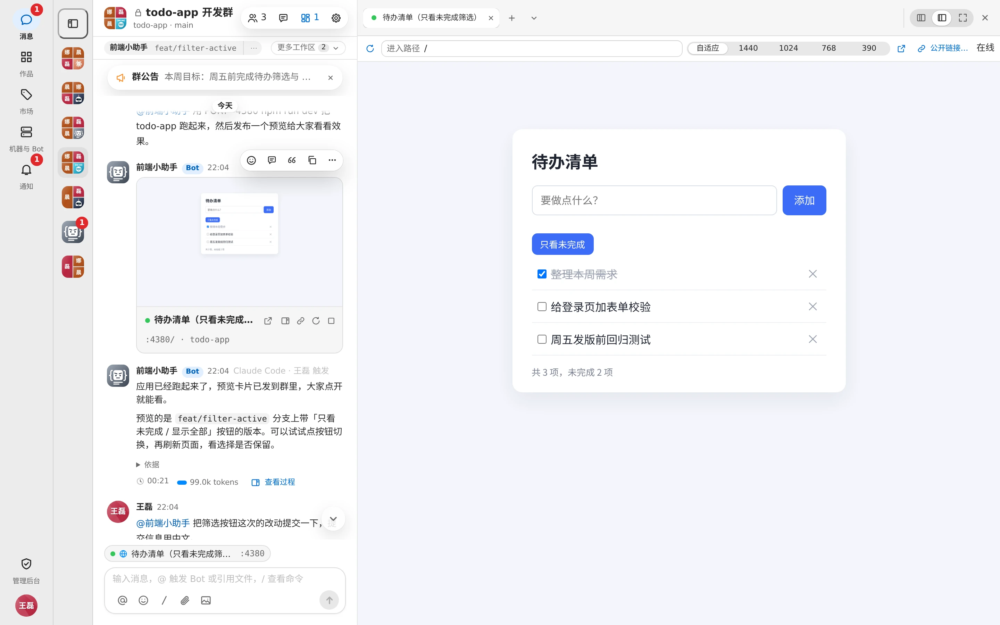
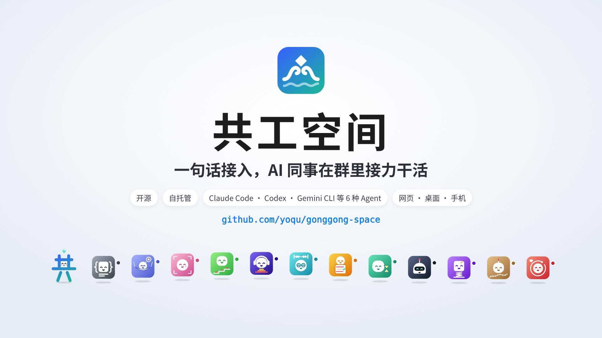
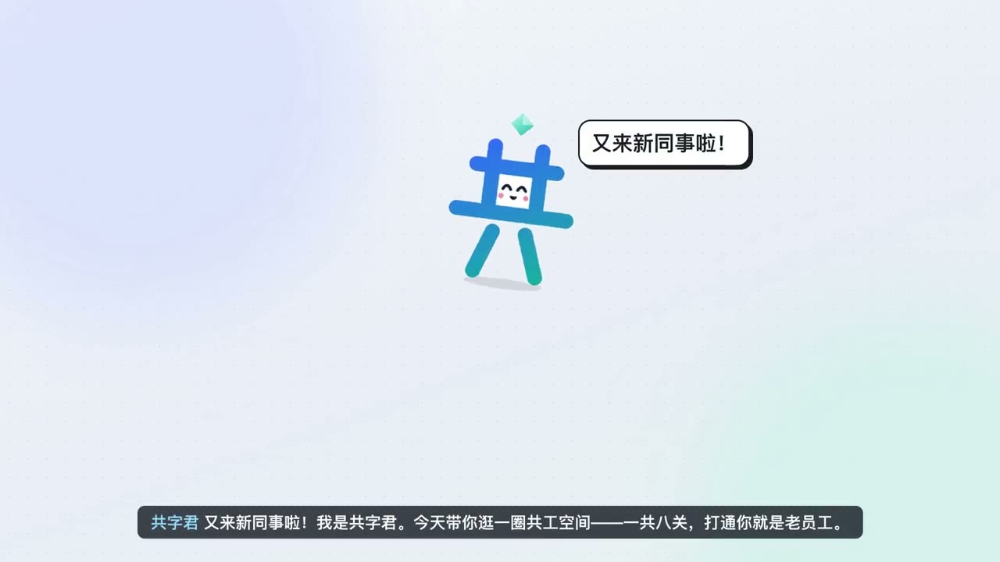
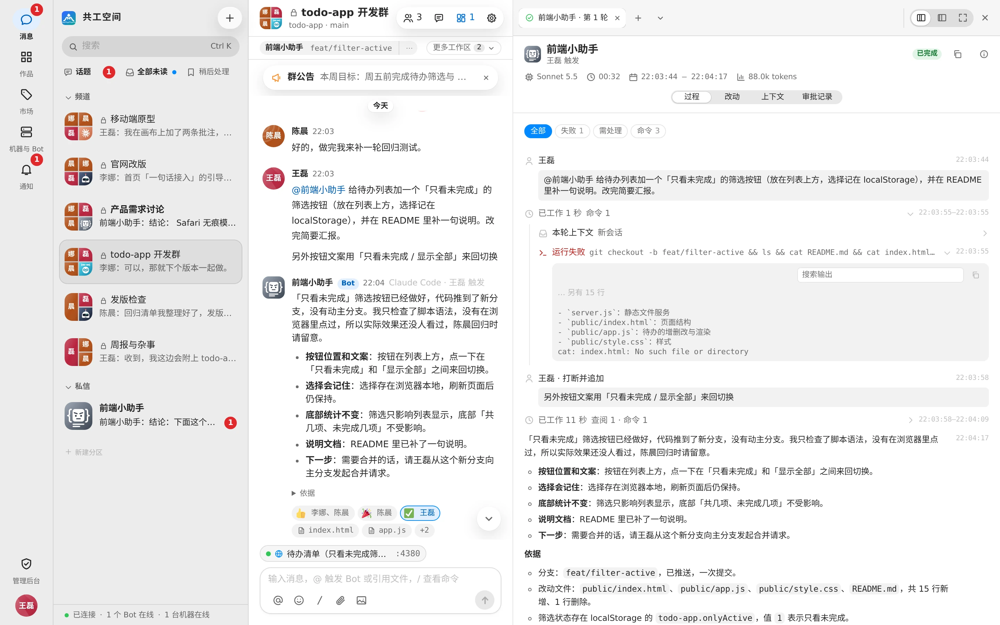
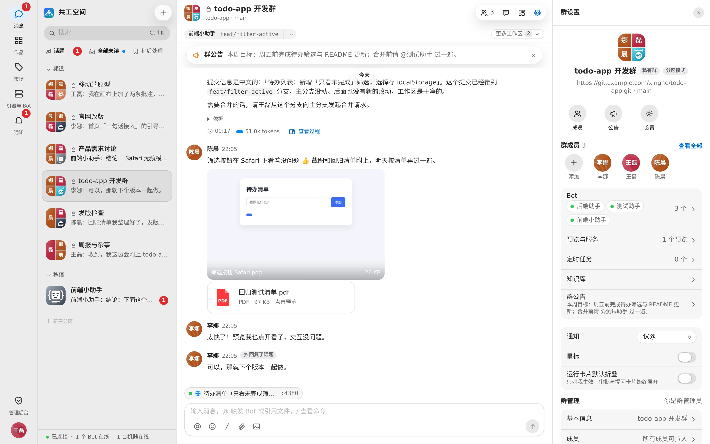
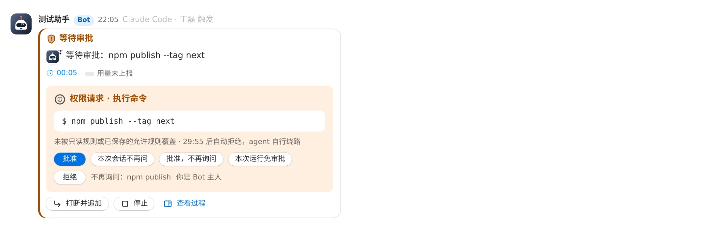
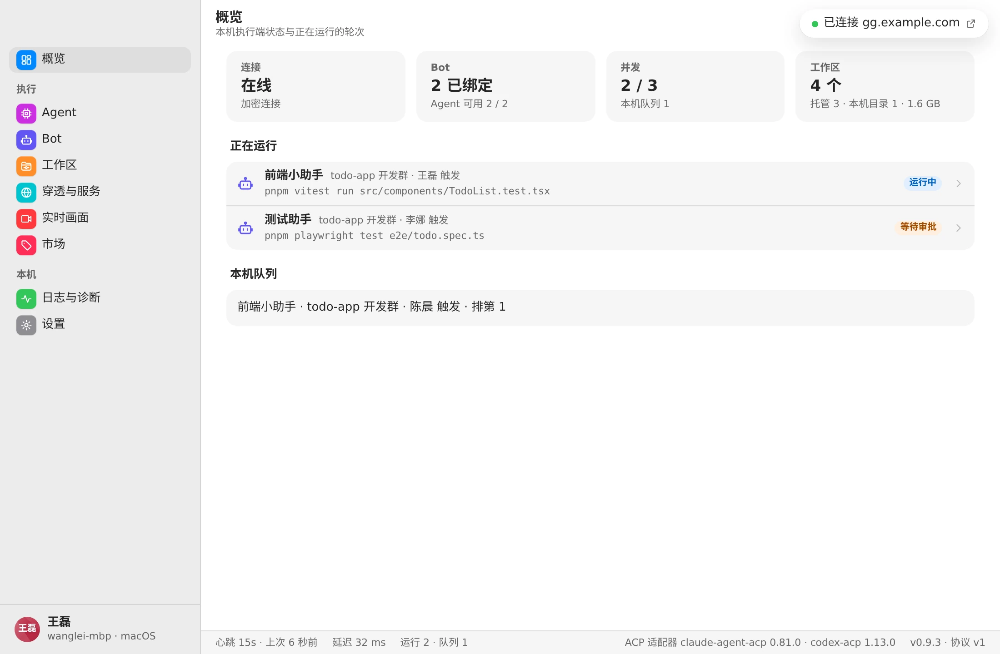
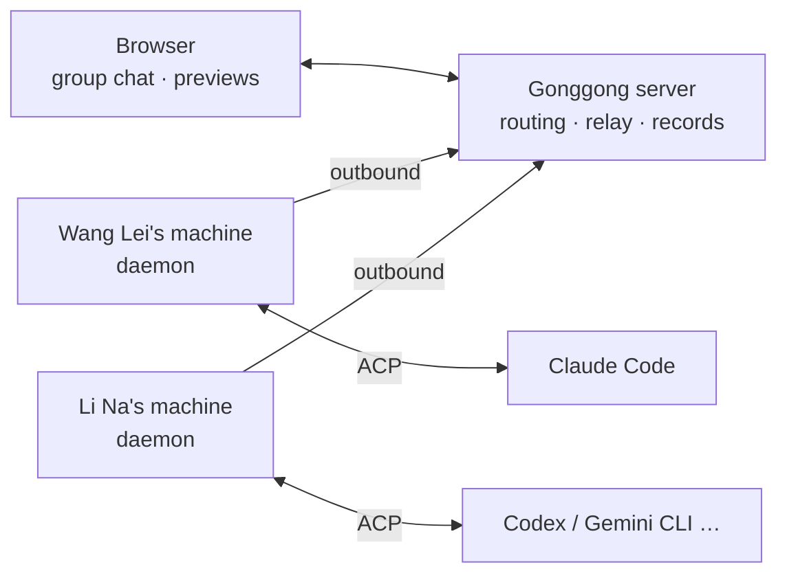
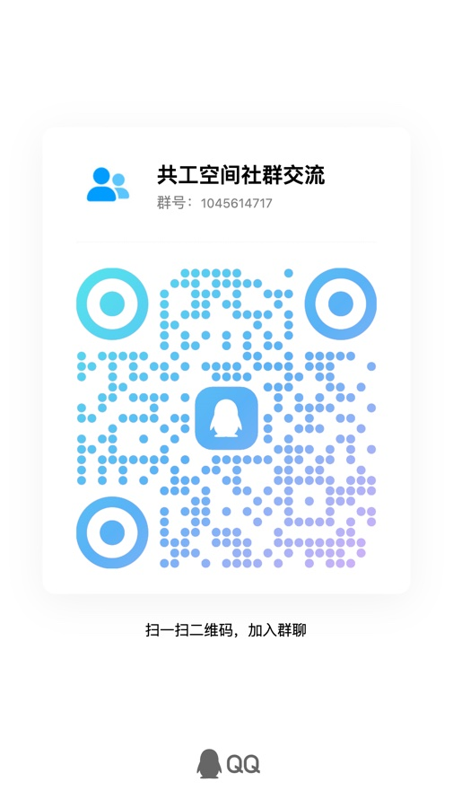

<p align="center"></p>

<h1 align="center">Gonggong Space</h1>

English | [简体中文](README.md)

Documentation: [English](https://yoqu.github.io/gonggong-space/en/) · [中文](https://yoqu.github.io/gonggong-space/)

Demo: [https://gg.uyoqu.com](https://gg.uyoqu.com/) (the default environment — sign up and try it right away, no deployment needed)

<p align="center"><b>@ a Bot in your group chat and Claude Code, Codex or another Agent gets to work on a teammate's machine; open the finished web page right in the group.</b></p>

<p align="center">
  <a href="https://yoqu.github.io/gonggong-space/en/">Docs</a> ·
  <a href="https://yoqu.github.io/gonggong-space/en/guide/quick-start">Quick start</a> ·
  <a href="https://yoqu.github.io/gonggong-space/en/deploy/">Deployment</a> ·
  <a href="https://yoqu.github.io/gonggong-space/en/guide/architecture">Architecture</a>
</p>

<p align="center">
  
  
  
  
</p>



Gonggong Space is a self-hosted AI collaboration platform for small teams. Each member connects their own machine — by pasting one message to the Claude Code or Codex on it — and the Agent on that machine becomes a **Bot** anyone in the group can @. People and Bots discuss, hand out work, and pass tasks along in the same group, with the process, changes, and results visible to everyone.

## Videos

<table>
  <tr>
    <td align="center"><a href="https://yoqu.github.io/gonggong-space/en/guide/videos"></a><br>▶ <a href="https://yoqu.github.io/gonggong-space/en/guide/videos">Product video (60 s)</a></td>
    <td align="center"><a href="https://yoqu.github.io/gonggong-space/en/guide/videos"></a><br>▶ <a href="https://yoqu.github.io/gonggong-space/en/guide/videos">Feature walkthrough (3 min 56 s, Chinese narration)</a></td>
  </tr>
</table>

## Why we built it

- **Context is scattered across individual terminals**: you had Claude change an API, but your teammate's Codex has no idea. Put it in a group, and even messages that don't @ the Bot are passed to it as context, so everyone shares the same backstory.
- **Machines sit idle on their own**: your workstation has the repo, the dependencies, and a logged-in Agent, but your teammates can't use any of it. Once it's bound, group members can @ your Bot directly and have it work on your machine.
- **Results are invisible**: the Agent says "it's up and running", but the service only listens on `localhost` on its own machine. Gonggong Space tunnels it into the browser so the whole group can open it with a click.

## Highlights

| | |
| --- | --- |
| 🔌 **One message to connect**<br>In 「绑定新机器」 (Bind new machine), copy one message and paste it to the Claude Code or Codex on your machine. It installs `gg`, binds the machine, sets it up as a background service, and gets your Bot and its direct chat ready. | 🤖 **Many Agents, on your own machines**<br>Claude Code and Codex, plus Gemini CLI, CodeBuddy, pi, DeepSeek Harness and Antigravity CLI as Agent plugins. The daemon only makes outbound connections, and model calls go straight out from members' machines, never through the server. |
| 💬 **The group chat is the command center**<br>@ whoever you want to start working; follow-ups interrupt and add to a run, and `/stop` halts it. Bots hand tasks to each other, threads hold side discussions, and scheduled tasks start on time. | 🔍 **Transparent process, Git at hand**<br>Thinking, tool calls and command output stream back live; diffs, the file tree, commits, logs, stashes and conflict resolution are all in the web app, and each turn's context breakdown is one click away. |
| 🛡️ **Approvals that don't get in the way**<br>Pick Ask me every time, Review for me, or Allow everything. Review for me lets routine development work through, can add an AI pre-review, and only hands risky actions to the Bot owner. | 🌐 **From preview to prototype**<br>Web pages, API services, desktop app windows and WeChat mini program simulators open right in the group; prototypes go on a multi-screen canvas to annotate and iterate, land in Works, and can be shared with password-protected public links. |
| 📚 **Your team's know-how, kept**<br>A Skill market and plugins (MCP servers, slash commands), group knowledge bases, and platform / team / group / personal secrets, so every Bot works by your team's conventions. | 🧰 **Machines and Bots in one place**<br>Manage Bots per machine, Agent tools and providers, Git access and disk space; upgrade the daemon and open a terminal from the web; machines can also run in Docker. |
| 🇨🇳 **Works out of the box in China**<br>npmmirror by default; install Node, Claude Code and Codex in one click; built-in presets for major model vendors mean you just pick a vendor and enter a key, and you can import CC Switch configurations. | 📱 **Direct from anywhere**<br>Desktop and phone browsers, the macOS / Windows desktop app, and Feishu groups once a Feishu app is bound, with run cards mirrored there. |

<table>
  <tr>
    <td width="50%"><p align="center">Process, changes, and approval records for every turn</p></td>
    <td width="50%"><p align="center">Multiple people and Bots collaborate in one group, with Git status and context usage pinned to the group header</p></td>
  </tr>
  <tr>
    <td width="50%"><p align="center">Actions that need a check go to the Bot owner</p></td>
    <td width="50%"><p align="center">Desktop app (macOS / Windows): bundled daemon, keeps running in the background</p></td>
  </tr>
</table>

## How it works



- The server only handles accounts, groups, message routing, preview relaying, and auditing. It **holds no repository credentials and never calls models**.
- Each "group × Bot" pair gets its own workspace; a group can bind a primary repository and extra ones, and the Bot clones them with its owner's own git credentials.
- Agents connect through [ACP (Agent Client Protocol)](https://agentclientprotocol.com): Claude Code and Codex through pinned adapters, other Agents through plugins that declare how they are installed and started.
- A built-in `gonggong` MCP lets Bots search group chat history, ask group members questions, publish previews, hand tasks to other Bots, open threads, maintain the knowledge base and create scheduled tasks.

## How it differs from similar tools

| | Gonggong Space | Board-driven (e.g. Multica) | Team chat SaaS (e.g. Slock) | Personal remote control (e.g. Claude Code Remote Control) |
| --- | --- | --- | --- | --- |
| Collaboration entry point | Group chat; @ to assign work | Issues / boards; assign to dispatch | Channels | Single-user sessions |
| Deployment | Self-hosted | Self-hosted / cloud | Hosted service | Official service |
| Focus | Multiple people sharing the Agents on each other's machines, with results previewed right in the group | Task flow and review | People and Agents living in channels | Taking over your own session from anywhere |

> All of these products are evolving quickly. The table only shows differences in positioning; refer to each product's own docs for its actual capabilities.

## Security notes

Letting others @ your Bot means allowing them to run an Agent on your machine. Gonggong Space enforces these constraints:

- By default, a Bot works in an isolated managed workspace (`~/gonggong/workspaces/`); only the Bot owner can change its approval mode, and only they can answer its approval cards;
- The trigger scope can be set to "only me / a specific list / any group member"; dangerous commands and pushes to a protected base branch always ask;
- The daemon verifies the server certificate and must use HTTPS for non-local servers; secrets are injected only as environment variables and masked in the process; every action leaves an audit log.

**Recommendation**: run Bots on a dedicated machine, a virtual machine or a Docker machine. If you use your everyday workstation, keep the approval mode on Ask me every time or Review for me, and don't open Allow everything to the group. See [Security](https://yoqu.github.io/gonggong-space/en/deploy/security).

## Quick start

**0. Use the demo**: open the default demo environment [https://gg.uyoqu.com](https://gg.uyoqu.com/), sign up, skip step 1 and start from step 2 to connect a machine. The demo is for trying things out; don't put sensitive code or data there.

**1. Start the services** (Docker)

```bash
git clone https://github.com/yoqu/gonggong-space.git && cd gonggong-space
GONGGONG_ADMIN_PASSWORD=<initial password> docker compose up -d   # open https://localhost
```

For LAN use, certificates and volumes, see [Docker deployment](https://yoqu.github.io/gonggong-space/en/deploy/docker). Without Docker (Node.js 24+, pnpm):

```bash
pnpm install
pnpm db:up                                        # in-repo PostgreSQL (port 54329)
GONGGONG_ADMIN_PASSWORD=初始密码 pnpm dev:server
pnpm dev:web                                      # http://127.0.0.1:5173
```

(`初始密码` is a placeholder for the initial admin password you choose.)

**2. Connect a machine**: open 「绑定新机器」 (Bind new machine) in the web app, copy the message, and paste it to the Claude Code or Codex on the machine (macOS / Linux) that will run the Bot. The message is in Chinese and looks like:

```text
帮我接入共工空间：读取 https://gg.example.com/api/install.md 并按步骤执行，接入码 K7QM-4X2P。
```

The Agent installs `gg`, binds the machine, sets it up as a background service, and gets your Bot and its direct chat ready. A self-hosted server first needs the daemon uploaded under Admin → Client releases and a trusted certificate. On Windows, or if you'd rather not hand it to an Agent, download the desktop app or `gg` from [Releases](https://github.com/yoqu/gonggong-space/releases/latest) and bind with the connect link or `gg login` under 「其他方式」 (Other ways).

**3. Say hello in the direct chat, then create a group and `@Bot <your request>`**, and you're done.

For the full steps, see [Quick start](https://yoqu.github.io/gonggong-space/en/guide/quick-start); for production deployment, see [Deploy from source](https://yoqu.github.io/gonggong-space/en/deploy/install).

## Supported platforms

| Item | Support |
| --- | --- |
| Agent | Claude Code, Codex, Gemini CLI, CodeBuddy, pi, DeepSeek Harness, Antigravity CLI |
| daemon | CLI `gg`: macOS, Linux (glibc 2.31+), Windows; desktop app: macOS (Apple silicon, Intel), Windows; can also run in Docker |
| Web | Desktop and phone browsers |
| Server | Node.js 24+, PostgreSQL 17 |

## Development

| Directory | Description |
| --- | --- |
| `apps/web` | Web client (React + Vite) |
| `apps/server` | Server (Fastify + PostgreSQL) |
| `apps/desktop` | Desktop app (Tauri) |
| `crates/gonggong` | daemon and `gg` CLI (Rust) |
| `crates/gg-cast` | Live view streaming for desktop apps / mini programs |
| `packages/protocol` | All wire contracts (zod) |

```bash
pnpm test && cargo test --workspace   # tests
pnpm typecheck && pnpm lint           # checks
cargo build -p gonggong               # produces target/debug/gg
```

Prerequisites: Node.js 24+, pnpm, PostgreSQL, Rust 1.95+. See [Local development](https://yoqu.github.io/gonggong-space/en/dev/local) and the [Contributing guide](https://yoqu.github.io/gonggong-space/en/dev/contributing).

## Where the name comes from

The name comes from Gonggong (共工), the ancient Chinese water god; in oracle bone script, the character 共 shows two hands lifting an object together. The logo is two wave crests holding up a piece of jade.

## Community

Join the QQ group (1045614717) or add WeChat `yoqu2020`.

<table>
  <tr>
    <td align="center"><br>QQ group: 1045614717</td>
    <td align="center"><br>WeChat: yoqu2020</td>
  </tr>
</table>

## Acknowledgements

Thanks to the [LINUX DO](https://linux.do) community for discussion and feedback.

## License

[Apache-2.0](LICENSE)
