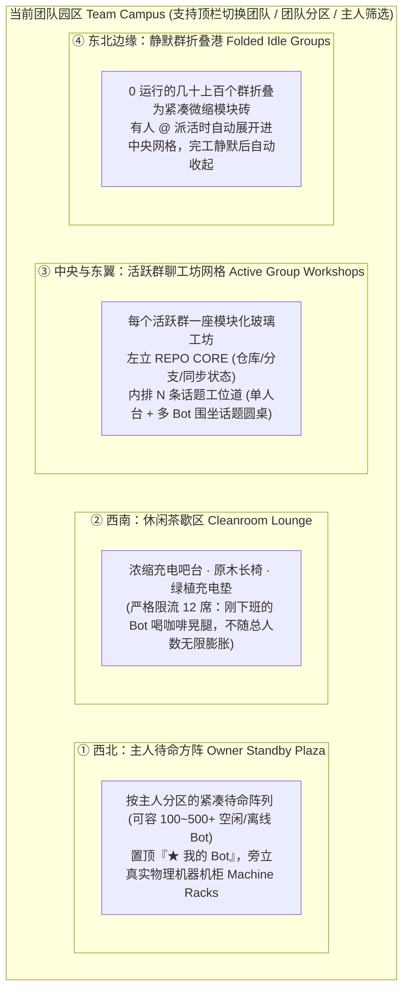

# 共工「3D 算力工厂总控」规模化空间设计定稿

> 核心原则：**交互去繁就简，重点吃透「高密度、大规模」**。
> - **多任务并发极简化**：同一个 Bot 同时在多个群聊或多个话题施工时，**不拉复杂的空中光纤线，直接在各施工工位生成同款复制实例**（带相同 Bot 名与主人脚底色环；点选任一实例时，右侧面板列出它在其他群的并行工位，支持一键切镜）。
> - **大规模弹性承载**：围绕 **「团队 › 群聊 › 话题/需求工位 + 休闲区 + 主人待命方阵 + 折叠静默群」** 四大功能区做模块化网格自动排布，配合**远/中/近三级语义缩放（LOD）**，从 20 个 Bot 到 200+ 个 Bot 始终井然有序、60fps 丝滑运行。

---

## 1. 四大空间分区与百级规模扩容机制

### 规模膨胀时的 4 条秩序铁律
1. **群聊按「有活才开房」动态伸缩**：团队哪怕有 100 个群，平时真正同时跑任务的往往是 5～15 个。只有活跃群和置顶群展开为实体玻璃工坊；其余 85 个静默群全部收在边缘 **「折叠静默群港」**，占地不到 10%。
2. **群内需求/话题按「标准产线矩阵」自动续排**：
   - 小群 1～2 个话题 = 紧凑双工位小舱；
   - 核心大群同时跑 8～16 个需求话题 = 自动扩展为整齐的 `2 排 × N 列` 流水线工位道；同一话题下多 Bot 协同则自动拼成 **话题协作圆桌**。
3. **休闲区「定量封顶（12 席 LRU 轮换）」**：刚干完活的 Bot 去休闲区喝杯充电咖啡放松，超过 12 个时最早休息完的自动归队到西北角的**主人待命方阵**，保证休闲区永远精致松弛，绝不会挤成菜市场。
4. **远 / 中 / 近三级语义缩放（Semantic Zoom LOD）**：
   - **远景全局鸟瞰（Macro）**：收起所有细碎小字，只显示 **群聊工坊大铭牌（如 `#支付重构 · 6工位 · 1待审`）** 与琥珀色待审批高光信标，百群百 Bot 全局热力一目了然；
   - **中景街区巡航（Meso）**：显示话题名称、Bot 主人色环、复制实例工作动态；
   - **近景工位特写（Micro）**：展开工位悬浮 **`Todo [■■■□□ 3/5]` 工序条**、**上下文液位柱（`Context 68%`）**、**子代理无人机**、以及角色本体微表情与异常标识（待审批举琥珀牌、鉴权过期举红钥匙、CLI 需升级黄标）。

---

## 2. 系统概念 → 3D 视觉元素速查表

| 共工概念 | 3D 场景视觉落点 |
|---|---|
| **团队 (`TeamDto`) & 分区 (`TeamSection`)** | 顶栏左侧团队切换器 + 业务分区过滤胶囊（一键只看某条业务线街区） |
| **Bot 归属用户 (`ownerId` / `sharedWith`)** | **脚下磁吸身份光环**（`★ 我的 Bot` 双层暖金环、同事 Bot 专属成员色环）+ 顶栏 **「只看我的 Bot」聚光灯**（一键柔化他人 Bot） |
| **同 Bot 跨群/多需求施工 (`concurrency`)** | 各需求工位直接站立**同款同名复制小人**；点选任一实例，右侧抽屉显示 `并行施工中 (3/4 槽)` 并可一键切镜巡视其余分身工位 |
| **群聊 → 话题 (`GroupDto` → `Thread`)** | 玻璃工坊舱 = 群聊；舱内独立产线台 = 单线需求，环形圆桌 = 多 Bot 联合攻关的话题 |
| **工作区与 Git (`Repo` / `mode` / `/cd`)** | 工坊内发光全息分支树母台 `REPO CORE`（分区模式 vs 强制同步冲突告警）+ 桌角分支/脏文件计数铭牌 |
| **Bot 的 Todo (`run.plan: PlanItem[]`)** | 工位上方悬浮 `TODO [3/5]` 进度条与当前步骤；右侧抽屉展示完整勾选清单 |
| **Bot 自身状态 (`Presence` / `Context` / `Tier`)** | 桌角透明脑容量液位柱（上下文占比与自动压缩）、头顶思维光环/审批灯牌、权限护盾、离线/版本过低状态灯 |
