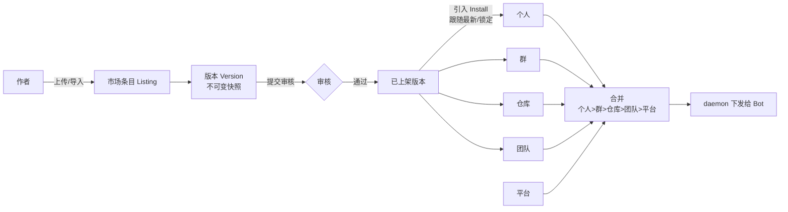

# Skill 市场 PRD

> 状态：草案（2026-11-04），待姜维川评审。前置文档：`插件体系-方案.md`（市场原排在 P5）、`团队Skill-开发计划.md`。

## 1. 背景与目标

- 现状：Skill 和插件都按「平台 → 团队 → 群」三层管理，只能由该层管理员在设置里手工创建或上传。没有个人层，也没有地方发现别人做好的 Skill，同一个 Skill 在不同群里要重复上传。
- 目标：
  1. 任何用户都能上传 Skill，上架到市场；
  2. 在市场里一键引入到 **个人 / 群 / 仓库 / 团队**；
  3. 引入方式是订阅（跟随作者更新，也可以锁定版本），不是复制。
- 不做（一期）：付费、评分评论与排行、安全自动扫描、hooks 与可执行 MCP。

## 2. 已拍板的决策（姜维川 2026-11-04）

| # | 决策 |
|---|---|
| D1 | 全平台**一个**公共市场。上架时选择可见范围：**公开**（所有登录用户可见）或**仅本团队** |
| D2 | 个人层 = 「我的 Skill」：只在**我发起的运行**里生效，跟着我进入所有群 |
| D3 | 项目 = 仓库（`repos`）。引入到仓库后，对所有以它为主仓库的群生效。只在平台侧绑定，不改仓库代码 |
| D4 | Skill 市场与插件市场**合一**：Skill 是最轻量的插件，用同一套 manifest 和市场页 |
| D5 | 上架需要审核：公开范围由平台管理员审核，仅本团队范围由团队管理员审核 |
| D6 | 支持从 GitHub 仓库或子目录、ZIP、单个 `SKILL.md` 导入 |
| D7 | 引入后订阅更新：默认跟随最新的已审核版本，可以锁定版本；作者发新版后提示升级 |
| D8 | 同名 Skill 的优先级：**个人 > 群 > 仓库 > 团队 > 平台** |
| D9 | 对应层的管理员可以直接引入；普通成员只能发起「申请引入」，由该层管理员审批 |

## 3. 概念模型

- **市场条目（Listing）**：一个可分发的包，即现在的 `plugins` 加上作者、可见范围和上架状态。类型分为 `skill`（只有一个或多个 SKILL.md）和 `plugin`（带模板、设计系统、inputs 等，即现有的创作插件）。
- **版本（Version）**：沿用 `pluginVersions`，是不可变快照。每个版本单独审核。
- **安装（Install）**：引入记录，字段为 `{listingId, scope, scopeId, pin: versionId | null, enabled}`。`pin = null` 表示跟随最新的已审核版本。
- **本地 Skill**：现在三层中手写的 Skill（`skills` 表）保持不变，参与同样的合并。可以从本地 Skill「发布到市场」。

## 4. 角色与权限

| 操作 | 谁可以 |
|---|---|
| 上传、导入、编辑自己的条目 | 任何登录用户（作者） |
| 提交上架：仅本团队 | 作者，需是该团队成员；由团队 admin 审核 |
| 提交上架：公开 | 作者；由 sysadmin 审核 |
| 引入到个人 | 本人，不需要审批（个人范围只用已审核版本，或自己的未上架草稿） |
| 引入到群 | 群管理员直接引入；群成员发起申请，由群管理员审批 |
| 引入到仓库 | 仓库所属团队的 admin 直接引入；团队成员发起申请 |
| 引入到团队 | 团队 admin 直接引入；团队成员发起申请 |
| 下架 | 作者（只影响新引入）；审核方可以强制下架（已有安装停止跟随更新，并标记「已下架」） |

## 5. 生效规则

- **合并**：按 D8 从低到高叠加，同名时高层覆盖低层。群管理员仍然可以在群里关掉继承来的项，沿用 `groupSkillOverrides` 和 `groupPlugins`。
- **个人层的「我发起的运行」**：
  - 群里 @Bot：发起人是 @ 的那个人；
  - `hand_off` 接力：继承上一棒的发起人；
  - 定时任务：发起人是任务创建者；
  - Bot 自己发起或系统触发：没有个人层。
- **个人 Skill 只在发起人本人的运行里生效**，群里其他人看不到它的内容。群消息的运行详情里只显示「使用了 N 个个人 Skill」。
- **仓库层**：取群的主仓库（`groupRepos.isPrimary`），按 `repos.key` 匹配团队仓库，读取该仓库的安装记录。
- **生效时机**：与插件一致，下一轮运行生效，不打断正在进行的运行。
- **兼容性**：沿用插件对 agent 种类和 `minDaemon` 的要求；条件不满足时不下发，并在界面上说明原因。

## 6. 功能清单

### 6.1 市场页（左侧导航「市场」）
- 列表：搜索；按类型（Skill / 插件）、分类、来源（官方 / 本团队 / 公开）筛选；排序按最新或安装数。
- 卡片：图标、名称、作者、简介、支持的 agent、安装数、「已引入到 N 处」。
- 详情页：README（渲染 SKILL.md）、文件树、版本历史与更新说明、许可证与来源，以及「引入到…」按钮。

### 6.2 上传与导入（「我的发布」）
- 四种来源：在线新建（编辑 SKILL.md）、ZIP 上传、GitHub 链接（可以指向子目录或 ref，默认固定到 commit）、粘贴单个 SKILL.md。
- 导入时校验：
  - 必须有 SKILL.md 的 frontmatter `name/description`；
  - 自动生成最小 manifest（`type: skill`）；
  - 大小上限沿用插件；
  - 文件中的密钥、绝对路径给出提示（人工确认，不拦截）。
- 发版：修改后生成新版本，填写更新说明，选择可见范围，提交审核。草稿可以直接引入到「个人」自测。

### 6.3 引入弹窗
- 选择目标：我的个人 / 我管理的群 / 仓库 / 团队（没有权限的目标显示为「申请引入」）。
- 选择版本策略：跟随最新（默认）或锁定当前版本。
- 冲突提示：目标层已有同名项时，提示将覆盖哪一层的哪个 Skill。

### 6.4 管理入口
- 个人设置新增「我的 Skill」：查看已引入和自己创建的 Skill，可以开关、升级、移除。
- 群设置、团队设置的 Skill/插件 tab 新增「从市场引入」，已引入的项标注来源、版本，并显示「有更新」徽标。
- 仓库设置（团队管理 → 仓库）新增「Skill」tab。
- 审核台：团队管理和平台配置中各有「待审核」列表，可以查看 diff（相对上一已审核版本）、通过、驳回（必须填写原因）。
- 申请引入：通知该层管理员，在管理入口处理；结果通过站内通知告知申请人。

### 6.5 更新与通知
- 跟随最新的安装：新版审核通过后，下一轮运行自动生效，并在设置中留下记录。
- 锁定版本的安装：显示「有新版 vX」，管理员手动升级。
- 作者下架或被强制下架：已有安装继续使用当前版本，标记为「已下架」。

## 7. 数据与接口草案

- 扩展 `plugins`：新增 `type (skill|plugin)`、`authorId`、`visibility (public|team)`、`listedVersionId`、`status`。scope 字段保留，用于兼容官方内置条目和团队私有条目。
- 扩展 `pluginVersions`：新增 `reviewStatus (draft|pending|approved|rejected)`、`reviewerId`、`reviewNote`、`changelog`。
- 新表 `installs`：`listingId, scope (user|group|repo|team|platform), scopeId, pinVersionId?, enabled, installedBy`。现有的 `groupPlugins` 迁移进来。
- 新表 `install_requests`：`listingId, scope, scopeId, requesterId, status, decidedBy`。
- 接口：
  - `GET /api/market`（列表与搜索）、`GET /api/market/:id`；
  - `POST /api/market/import`；
  - `POST /api/market/:id/versions/:v/submit`、`/review`；
  - `POST /api/installs`、`/api/install-requests`。
- daemon 下发：合并结果中新增个人层和仓库层。按运行的发起人计算 skill-set，所以 daemon 端的 skill-set 键要从 `<group>-<bot>` 扩展为 `<group>-<bot>-<initiator 摘要>`（发起人没有个人 Skill 时沿用原键，避免目录膨胀）。

## 8. 分期

| 期 | 内容 | 迁移 |
|---|---|---|
| M1 底座 | Listing、Install 模型；把现有 `groupPlugins` 迁移进来；仓库层；合并规则改为五层 | 有 |
| M2 市场与发布 | 市场页、详情页、导入（ZIP / SKILL.md / GitHub）、引入弹窗、版本跟随与锁定 | 有 |
| M3 个人层 | 「我的 Skill」，按发起人下发，hand_off 和定时任务的发起人传递 | 有，daemon 改动 |
| M4 审核与申请 | 上架审核台、申请引入、通知 | 有 |

每期都涉及数据库迁移和三端改动，按约定开工前确认。

## 9. 待确认问题

1. **个人 Skill 的隐私**：个人 Skill 会下发到 Bot 主人的机器上，主人可以在磁盘上读到内容。是否接受？还是只允许在自己的 Bot 上生效？
2. **公开条目是否要求许可证**：公开上架时是否必须填写许可证？GitHub 导入时是否保留原许可证与来源（沿用 manifest 的 `source` 字段）？
3. **GitHub 导入后的同步**：只做手动「检查上游更新」，还是要定时同步？同步出的新版本仍需审核。
4. **作者离开团队**：作者离开后，团队范围的条目由谁接管，团队 admin 吗？
5. **桌面端**：桌面端是否只读展示，引入与上传都只在 web 端做（与供应商的做法一致）？
