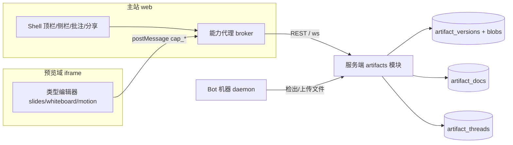

# 产物容器（幻灯片 / 白板 / 动效）· 开发计划

> 提出：姜维川 2026-11-23。状态：已定待开工（D1–D4 姜维川 2026-11-23 确认）。参照项目：[JimLiu/open-artifact](https://github.com/JimLiu/open-artifact)（Apache-2.0，调研时 HEAD `d70879a`）。现状见 `docs/domains/产物与原型编辑器.md`。

## 1. 目标与已定范围

现在托管到服务器的 PPT 和网页都套在原型的框架里（画布 + 设备外壳，或者原型顶栏 + 裸 iframe），不适合非原型类产物。这次要做一个通用的产物容器（下文叫 Shell），在作品库、群卡片、新标签页和分享页里统一打开各类产物。

已定（2026-11-23 群内选择）：

- 一期类型：**幻灯片、白板、动效**。原型继续用现有画布，托管网页接进 Shell，不单独做。
- 代码来源：**混合**。引擎类代码从 open-artifact 移植并保留 NOTICE；Shell 和外框按我们的设计系统写。
- 幻灯片格式：**两种都支持**。现有单文件 HTML 只读演示；新增 `deck.json` + `slides/*.html`，可以逐页编辑。
- 编辑深度：**一期就做所见即所得的直接编辑**。

## 2. 调研结论（open-artifact 源码）

| 结论 | 依据 | 对我们的影响 |
|---|---|---|
| 编辑器不直接连后端，都运行在 Shell 内的 iframe 里，通过 `window.openartifact.use(name)` 拿到能力，经 `postMessage` 由 Shell 代为执行（`cap_want / cap_grant / cap / cap_r / cap_ev`） | `packages/runtime/src/broker.ts`、`capabilities.ts`（合约 1.4.0） | **我们写自己的 Shell，在其中实现能力代理、对接服务端，就能直接跑它的编辑器**，不必重写编辑器 |
| 编辑器代码量：幻灯片约 4.1 万行（editor 3.1 万 + core 1 万），白板约 6.8 万（含 Rust 几何 0.7 万），动效约 4.4 万（editor/stage/export/audio/core + Rust 0.3 万）；共享的 editor-kit 0.84 万、runtime 0.32 万 | 统计 `packages/*` 非测试源码 | 按我们的设计系统重写这三个编辑器，代价是现有原型编辑器的数倍，不现实 |
| 白板同步不是 CRDT：每个元素一个 JSON 文档，提交 JSON merge patch，按字段合并，同一字段后写的生效；写入时带 `ifMatch` 哈希，冲突整批拒绝 | `packages/live-store/src/engine.ts`、`transport.ts` | 服务端只需实现 `db` 能力（文档读写 + 变更推送），不必引入 CRDT 库 |
| 落盘就是普通文件：白板 `db/board/meta.json` + `db/elements/<id>.json`；动效 `db/film/meta.json` + 场景文档；幻灯片 `project/deck.json` + `deck.css` + `slides/<id>.html` | `test-artifacts/`、`artifact-types/*/artifact-type.json` | 可以直接套用现有的版本/blob/检出模型，Bot 照常读写文件 |
| 动效导出 MP4 在浏览器里完成：WebCodecs 编码 + `mediabunny` 封装，GIF/MOV 用 Rust→WASM | `packages/motion-export/src/video/format.ts`、`gif/`、`mov/` | **导出不需要 Bot 电脑和 ffmpeg**，上一轮提的风险 3 不存在 |
| PPTX 导出在浏览器里完成：离屏渲染每页，按元素读出位置和样式，转成原生文本框、形状、表格和备注；转不了的元素画成图片 | `packages/slides-editor/src/services/export/pptx.ts`（导出目录共 0.48 万行） | 只对 `deck.json` 格式有效；单文件 HTML 只能「每页一张图」导出 PPTX |
| WASM 产物已提交在 `packages/wasm-*/generated/` | 仓库内 | 构建不需要 Rust 工具链 |
| editor 包没有发布到 npm（`@open-artifact/slides-editor` 等 404），core、runtime、editor-kit 发布了 0.13.0 | `npm view` | 编辑器必须引入源码自己构建 |
| 编辑器界面用 Tailwind 4 + Base UI，配色走 `--color-chrome*` 等主题令牌 | `packages/editor-kit/README.md` | 把令牌映射到我们的主题变量，外观能接近，交互保留它的 |

## 3. 关键决定（2026-11-23 姜维川确认，D1–D4 均按推荐）

- **D1 编辑器用 open-artifact 的，我们只写 Shell 和能力代理**（推荐）。理由见第 2 节。外观上：Shell（顶栏、侧栏、批注列表、分享、导出入口）用我们的设计系统；编辑器内部的工具栏和面板沿用它的界面，套我们的主题色、字体和暗色模式。（已确认）
- **D2 白板同步沿用 live-store 模型**（按元素文档 + merge patch + `ifMatch`），不上 CRDT。
- **D3 导出都在浏览器里做**（PDF/PNG/PPTX/HTML/MP4/GIF）。MP4 需要支持 WebCodecs 的浏览器（Chrome 系、Safari 17+、桌面客户端）；不支持时只给 GIF/HTML，并提示换浏览器。
- **D4 数据库迁移**：按第 5 节做（已确认）。

## 4. 架构

### 4.1 类型注册

- `artifacts.kind`：`prototype | site | slides | whiteboard | motion`，创建时由插件清单决定，不可改。现有数据：`site_dir` 非空的是 `site`，其余是 `prototype`。
- 插件清单 `PluginManifest.artifact` 增加 `kind`、`editor`（编辑器在插件包里的目录）、`exports`、`store: 'files' | 'db'`。官方插件新增 `whiteboard`、`motion`；`slides` 插件增加 `deck` 格式模板。
- 编辑器构建产物放在插件目录 `editor/`，按插件版本由预览域在 `/__oa/<plugin>@<version>/` 下提供（与现有 `_gg/` kit 同一套按插件版本取文件的逻辑）。产物固定用创建时的插件版本，避免编辑器升级破坏旧产物；Shell 提供「升级编辑器」。

### 4.2 Shell（web `features/artifacts/shell/`）

- 顶栏：产物菜单、标题、版本、运行状态 / 正在改、在场头像、批注、AI 对话、演示 / 全屏、导出、分享。
- 侧栏：批注、AI 对话（复用 `chat.ts` 的隐藏对话）、版本历史、编辑器自己报告的面板。
- 内容区：预览域 iframe 加载编辑器；按 `kind` 选择：`prototype` 继续用 `ArtifactTab` 画布；`site` 用裸 iframe + 坐标批注；`slides/whiteboard/motion` 用 open-artifact 编辑器。
- 编辑器通过 `shell` 能力报告顶栏状态（`chromeReporter`）、接收命令；Shell 只信任预览域精确 origin 且 `source` 是编辑器 iframe 的消息（与现有 `bridge.ts` 同一规则）。
- 作品库、群卡片、新标签页、分享页都用 Shell；访客只读，只授予 `artifact`（读）、`user`（访客）、`downloads`。

### 4.3 能力代理映射

| 能力 | 我们的实现 | 备注 |
|---|---|---|
| `artifact` list/readText/readBytes | 读 head（或固定版本）的清单和 blob | |
| `artifact.publish` | 一批文件生成一版（`source=edit`），每个文件带 `ifMatch` 哈希；不是 head 上的修改返回 `conflict` 并列出冲突路径 | 对应现有 `onlyHead` 语义 |
| `artifact.onChange` | head 变化时推送变更的路径；自己发起的发布不回显 | 走 `/ws/web` 现有总线 |
| `assets` | 上传进本产物 blob，返回 `/_blob/<hash>`，预览域提供该路径 | 沿用图片魔数校验、拒绝 SVG |
| `user` | 当前成员或访客，角色由 `viewArtifact` / `requireArtifact` 算出 `owner / editor / viewer` | |
| `agent` | 转成以当前成员身份发到产物 AI 对话的 @Bot 消息，状态取自 run | 发给 agent 的选区文本按它的 `fenceUntrusted` 加围栏 |
| `comments` | 新表 `artifact_threads`（见第 5 节），「发给 Agent」沿用 `open → sent → resolved` | 替代按 `ggId` 的批注，原型批注迁入 |
| `history` | `artifact_versions` 列表、预览、恢复（`restoreVersion`） | |
| `db` | 新表 `artifact_docs`，按路径读写、`ifMatch`、整批原子、变更推送 | 只给 `store: 'db'` 的类型 |
| `room` | `/ws/web` 按产物分房间转发在场和临时消息，不落库 | 与《多人光标方案》P3 共用一套通道 |
| `downloads` | 浏览器下载（`browser: true` 模式） | |
| `doc / sheet / mcp` | 不授予 | 一期没有这些类型 |

### 4.4 db 类型的存储与版本

- 实时编辑写 `artifact_docs`（一份文档一行），立即推给房间里的其他人。
- 落版：编辑停止 30 秒、Bot 开跑检出前、有人打开版本历史时，把文档序列化成文件（`db/elements/<id>.json` 等），生成一版 `source=edit`。版本、分享固定版本、检出都只看版本。
- Bot 改完上传：沿用 `submitVersion` 的按文件三方合并（一个元素一个文件，合并粒度就是元素）；合并出的 head 回写 `artifact_docs` 并推送变更。
- 不变量不变：返回给 daemon 的版本内容必须等于它本地的文件。

### 4.5 Agent 侧

- 每种类型一份 SKILL.md，从 open-artifact `artifact-types/<type>/SKILL.md` + `reference/` 改写：去掉它的 MCP 工具调用（`Artifact publish/call`），改为「直接写产物目录里的文件」；保留文件格式、上限和写作规则。
- 校验：服务端 `lint` 按 `kind` 调用对应 `*-core` 的检查（纯 TS，可在 Node 里跑），结果进 `issues`，只提示不拦截。
- 选区上下文：编辑器的 `room.presence({viewContext})` 写入下一条 @Bot 消息的 `meta`，复用现有画布上下文芯片的通道。

### 4.6 幻灯片的两种格式

- `deck`（新，`project/deck.json`）：完整编辑器，支持逐页编辑、总览、备注、逐步动画、转场、演讲者模式、`#slide-n`、按页批注，导出 PDF/PNG/HTML/PPTX（原生对象）。
- `single`（现有 slides 插件的单文件 HTML）：只读演示。用我们自己的轻量查看器：注入脚本识别顶层页（优先模板声明的选择器，其次顶层 `<section>`），提供缩略图栏、翻页、全屏、按页批注；导出 PDF/PNG，PPTX 每页一张图。模板自带的键盘翻页和演讲者模式保留。
- slides 插件新建的幻灯片默认改用 `deck`；现有模板逐步改写成 `deck.css` 主题，没改完的继续出单文件。

## 5. 数据模型改动（迁移已确认）

- `artifacts.kind text not null`（回填 `site` / `prototype`）、`artifacts.editor_version`。
- `artifact_threads`：`id, artifact_id, version_id, anchor jsonb, status, sent_message_id, created_by, created_at`；`artifact_thread_messages`：`id, thread_id, author_kind, author_id, text, to, reactions jsonb, at, edited_at`。`anchor` 由类型定义（原型 `{file, ggId}`、幻灯片 `{slide, path?, point?}`、白板 `{element?, point}`、动效 `{t, point?}`、网页 `{path, point}`）。现有 `artifact_annotations` 迁入后删除。
- `artifact_docs`：`artifact_id, path, value jsonb, hash, updated_by, updated_at`，主键 `(artifact_id, path)`；单文档上限与 open-artifact 一致，单产物文档数上限另定。

## 6. 协议与 daemon

- `packages/protocol`：`ArtifactKind`、插件清单新字段、`ArtifactThread*`、能力代理的消息类型（照搬 `cap_*` 结构，zod 定义）、`artifact_docs` 推送事件。
- daemon：不需要新能力。检出 / 上传本来就是文件级的；`db` 类型落版后同样是文件。fixture 只增加 `RunStart.artifacts[].kind`（让提示词按类型写）。

## 7. 引入 open-artifact 代码

- 用 `git subtree` 把固定提交引入 `vendor/open-artifact/`，只保留用到的包：runtime、protocol、editor-kit、export-kit、ui、canvas-engine、live-store、design-system-core、slides-*、whiteboard-*、motion-*、wasm-export / wasm-wb-geom / wasm-motion / wasm-canvas（含 `generated/`）。保留 LICENSE、NOTICE，在根目录 NOTICE 注明。
- 编辑器用它自带的 Vite 配置构建，输出到对应官方插件的 `editor/`。它要求 Node ≥ 22.18，与我们的 CI 对齐。
- 我们对 vendor 代码的改动只允许三类：主题令牌映射、去掉本地 daemon 专有入口（如本地文件路径、harness 唤醒）、修 bug。每处改动记在 `vendor/open-artifact/PATCHES.md`，升级时逐条重放。
- 体积检查和 biome 排除 `vendor/`；它的 `node --test` 单测在 CI 单独跑一遍。

## 8. 分段交付与验收

每段单独可用、单独上线；每段先写验收 / 集成测试再实现（TDD）。

| 段 | 内容 | 验收 |
|---|---|---|
| S0 容器与能力代理 | `kind` 与迁移；Shell 外框；broker（artifact/assets/user/history/comments/agent/downloads）；网页接入 Shell（坐标批注、AI 对话、版本历史）；原型批注迁入 `artifact_threads`；vendor 引入与构建流水线 | e2e：托管网页在作品库打开 → 加批注 → 发给 Bot → Bot 回复并产出新版本 → 版本历史可回退；分享页只读、访客拿不到写能力；旧原型批注数据完整迁移 |
| S1 幻灯片 | slides 编辑器接入；`deck` SKILL；单文件查看器；导出四种格式；按页缩略图 | e2e：群里让 Bot 做一份 `deck` 幻灯片 → 打开编辑器改字、拖顺序 → 演讲者模式 → 导出 PPTX 用 PowerPoint/Keynote 打开文字可编辑；单文件模板能翻页、批注、导出 PDF |
| S2 白板 | `db` 能力与 `artifact_docs`；`room` 在场与光标；落版；whiteboard SKILL | e2e：两个成员同时编辑同一白板，对方 1 秒内看到改动和光标；同一元素不同字段同时改都保留；Bot 往白板加便签后合并进当前内容；停止编辑 30 秒后出现新版本 |
| S3 动效 | motion 编辑器；motion SKILL；导出 MP4/GIF/HTML/ZIP | e2e：Bot 生成一段动效 → 在 Shell 里播放 → 改字和场景时长 → 在某一时刻加批注发给 Bot → 导出 MP4 可播放；不支持 WebCodecs 时只给 GIF/HTML 并提示 |

## 9. 风险与待查

- **编辑器嵌入的细节**：编辑器内部可能还会用 URL 直接加载产物文件（例如幻灯片用 iframe 渲染每一页），S0 先做一次 spike，把幻灯片编辑器跑在 broker 后面，列出它用到的所有能力和 URL 路径。
- **合约漂移**：open-artifact 迭代很快（0.13.0），每次升级按 `CONTRACT_VERSION` 检查能力合约变化。
- **动效的配乐与配音**：配乐是 agent 写的 `score.js`，浏览器里合成（`motion-audio`），一期照做；配音要 agent 录音或调 TTS 后上传，一期只支持播放已上传的音频，录制放到后面。
- **Bot 写入不是实时的**：open-artifact 里 agent 用 `ArtifactData` 逐条写文档，页面立刻看到；我们的 Bot 写文件，跑完上传才合并（动效的 SKILL 还要求只走 `ArtifactData`）。一期接受「跑完才出现」，靠「正在改」提示过渡；服务端上传时用 `*-core` 逐个文档校验。需要实时时再给 daemon 加 `artifact_data` 工具。
- **安全**：编辑器跑在预览域，不同产物共享一个 origin。需要确认按产物隔离（`/__oa/` 下的 broker 只回应本产物的 iframe），并保持 `nosniff`；分享页不加载有写能力的 broker。
- **体积**：三个编辑器加 WASM 的构建产物预计数 MB，按需加载，只在打开对应类型时下载。

## 10. 不做

- 表格、文档、数据看板、设计、设计系统这些 open-artifact 类型（原型已覆盖设计）。
- 它的本地 daemon、MCP 工具、harness 唤醒、远程站点同步、Cloudflare 托管：这些由我们的服务端和群聊替代。
- 原型画布不迁到 Shell 编辑器体系，只共用外框和批注。
