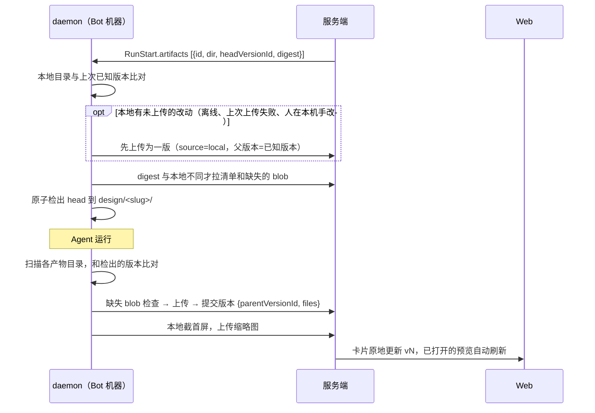
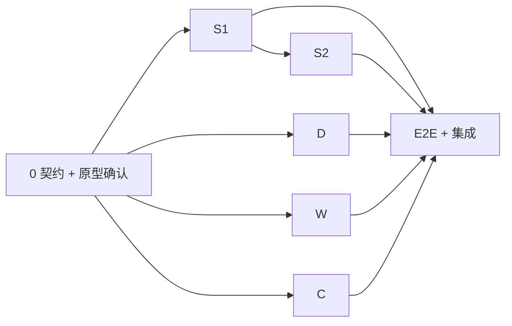

# 产物托管与编辑 · 开发计划（P3a 托管 + P3b 批注 + P3c 直接编辑）

> 对标 Google Stitch：AI 在 Bot 本机生成，文件以服务端为准，服务端渲染，右侧面板选中元素后批注或直接修改。方案背景见 `插件体系-方案.md` 第 6 节。分支 `feat/artifacts`。**有数据库迁移、跨 server / daemon / web 三端，推 main 前先确认。**

## 1. 已定决策（姜维川 2026-10-29）

| # | 项 | 结论 |
|---|---|---|
| A1 | 真相源 | 服务端为准。每轮开跑前把产物 head 检出到 Bot 本地；跑完上传新版本；面板手改直接在服务端生成新版本 |
| A2 | 托管范围 | 只托管产物目录 `design/<slug>/`，不托管整个工作区 |
| A3 | 首期范围 | P3a 托管、版本、产物卡片 + P3b 选中元素、批注、交给 AI + P3c 右侧面板直接编辑 |
| A4 | 样式落地 | 只改 `tokens.css` 变量和 inline style；增删、移动元素等结构改动一律交给 AI |
| A6 | 框架约束 | L1「固定外壳 + 约定」：平台固化外壳（设备边框、屏幕切换、跳转、桥接、基础样式），渲染时注入，AI 看不到也改不了；AI 只写清单、各屏 HTML 和 tokens。不合规不拦截，问题清单交给下一轮 AI 修。组件库（L2）和 JSON 结构描述（L3）不做 |
| A5 | 不做 | 无限画布、多屏连线和 Play、多方向分支视图、导出（zip / Figma）、从网址提取设计系统、版本对比、自动三方合并 |

## 2. 复用现有能力

| 需要 | 复用 | 改动 |
|---|---|---|
| 文件内容存储 | 强制同步的内容寻址 blob（`sync/blobs.ts`：按群目录、`seal.ts` 加密、哈希校验、5GB 群配额） | `purgeSyncBlobs` 把产物版本引用的哈希也算作存活 |
| daemon 扫描、哈希、上传、原子落盘 | `crates/gonggong/src/sync/`（`manifest.rs` 的 scan / hash_file，`apply.rs` 的原子写，`path.rs` 的路径安全，`client.rs` 的并发传输） | 抽出与「群副本」无关的部分，供 `artifacts.rs` 调用 |
| 独立预览域名、端口模式、分享链接 | `previews`（域名 / 端口两种模式，`preview_shares`） | `previews.kind` 新增 `'artifact'`，内容从服务端 blob 读取，不走隧道 |
| 缩略图 | `snapshot.rs`（机器本地的 Chrome 截首屏） | daemon 上传版本后，在本地静态服务上截图并随版本上传 |
| 卡片原地更新 | `MessageDto.card`（creation 卡） | 新增 `ArtifactCard` |
| 创作入口 | `creations.ts` | 创建时预分配产物和目录，指令不再要求 `preview_static` |

## 3. 模型与机制

### 3.1 数据（迁移，只新增）

- `artifacts`：groupId、pluginId、pluginVersionId、designSystemId、title、`dir`（`design/<slug>`，同群唯一）、headVersionId、createdBy、messageId（卡片）、archivedAt。
- `artifact_versions`：artifactId、`n`（产物内递增）、parentVersionId、`source`（`'run' | 'edit' | 'local'`）、runId / userId、`files` jsonb（`[{path, hash, size}]`）、digest、thumbnailHash、`stale`（父版本不是当时的 head）、createdAt。版本不可变。
- `artifact_annotations`：artifactId、versionId、ggId、selector、rect、snippet（元素外层 HTML，截断）、note、authorId、`status`（`'open' | 'sent' | 'resolved'`）、sentMessageId。
- `previews` 加 `artifactId`、`artifactVersionId`（为空表示跟随 head）。

### 3.2 一轮



- **RunStart.artifacts**：只下发与本轮相关的产物：触发消息引用的（创作、批注发送、回复产物卡片），以及本 Bot 产出或改过的未归档产物（最多 20 个）。避免把所有产物都检出到每个 Bot 的工作区，尤其是绑了用户仓库的工作区。只有机器带 `artifacts` 能力才下发。
- **提交**：父版本等于 head 时成为新的 head；否则保存为 `stale` 候选版本，不动 head。卡片提示「v5 基于 v3，期间有 v4」，由人选「采用此版本」（以它为内容、以当前 head 为父，生成新一版）或「交给 AI 合并」（@Bot 附两版说明）。
- **限制**：单文件 10MB、单版 50MB、最多 500 个文件；跳过 `node_modules`、`.git`、点文件。超限时本轮不上传，产物卡片上给出原因。
- **强制同步群**：先按强制同步补齐，再检出产物；产物检出的改动随本轮按强制同步提交，两套机制互不感知。
- **旧 daemon**：没有 `artifacts` 能力的机器继续走原来的 `preview_static` 指令，不建产物。

### 3.3 产物结构与外壳（L1）

已落地为产品原型插件 v0.4.0（模板 `app-screens`、设计系统 `luke-plus`、外壳 `kit/`），契约以插件的 SKILL.md 为准。

AI 写的（产物目录 `design/<slug>/`）：

```
gg-artifact.json        清单：{ title, device: "miniprogram" | "mobile" | "desktop", entry,
                               screens: [{ id, title, file: "screens/<id>.html", statusBar?: "light" | "dark" }] }
tokens.css              主题变量（从设计系统原样复制）
screens/<id>.html       每屏一个完整 HTML 文档，引用 ../_gg/gg-kit.css、../tokens.css、../_gg/gg-kit.js
assets/                 图片等
```

平台固化的（**放在插件包的 `kit/` 里，随插件版本走**）：
- `index.html` 外壳：设备边框、状态栏、小程序胶囊、屏幕切换、返回栈；读 `gg-artifact.json`；
- `_gg/gg-kit.css`：重置样式、设备变量（`--gg-status-bar`、`--gg-capsule-*`、`--gg-nav-height`、`--gg-safe-bottom`）、`.gg-ph` 占位图、`.gg-scroll-x`；
- `_gg/gg-kit.js`：`data-gg-link` / `data-gg-back` 跳转，在外壳里通过 postMessage 交给外壳，单独打开时跳到同级文件；
- 桥接脚本（见 3.4）由服务端另外注入。

过渡期（服务端外壳上线前）由 AI 把 `kit/` 原样复制成产物里的 `index.html` 和 `_gg/`，`preview_static` 照常能看。上线后服务端按产物记录的插件版本，从插件文件直接返回 `/`、`/_gg/*`，覆盖产物里的副本。Bot 本机的静态预览和自检截图也用同一份，两边渲染一致。

令牌命名（由 DESIGN.md front matter 机械生成，Stitch 同款格式）：`colors.x` → `--color-x`，`rounded.x` → `--rounded-x`，`spacing.x` → `--space-x`，`typography.x` → `--text-x-size/-weight/-leading` 和类 `.t-x`，字体统一 `--font-sans`。

约定（已写进 SKILL.md）：
- 颜色、圆角、字号只用令牌，色彩变化用 `color-mix()` 叠在令牌上；
- 不用构建工具，不引入框架、CDN 和网络字体（不用 Tailwind，避免 CDN 依赖和类名编辑的复杂度）；
- 内容写成静态 HTML，JS 只用于屏内交互，不用来生成内容；
- 不画状态栏、胶囊和 Home 指示条，不改 `index.html` 和 `_gg/`。

校验（`modules/artifacts/lint.ts`，每次版本提交后执行，结果存在版本上）：
- 清单可解析，屏 id 唯一，文件存在；
- `data-gg-link` 指向的屏存在；
- 写死的色值（`#xxx`、`rgb()` 出现在 style 或 `<style>` 里）；
- 出现外部脚本或样式；
- tokens.css 与设计系统不一致时只提示（人可能在主题面板改过，属正常）；
- `index.html`、`_gg/` 与插件 kit 不一致。

有问题时卡片显示「N 项规范问题」，下一轮 RunStart 的上下文附带问题清单（最多 20 条）。没有 `gg-artifact.json` 的产物（旧产物、其他插件）按单页 L0 渲染（入口 `index.html`）。

### 3.4 渲染与桥接

- 产物预览由服务端从 blob 读取，`/` 返回外壳页，`/screens/...` 等返回产物文件。每个预览一个 slug：跟随 head 的一个，查看历史版本时按需再开一个。HTML 走 3.5 的处理，其余文件按扩展名返回，加 `nosniff` 和 CSP sandbox。
- 只在成员打开的预览里注入桥接脚本 `/__gg/bridge.js`，分享链接不注入。脚本里写死主站 origin，`postMessage` 指定 targetOrigin；父页同时校验 `event.origin` 和 `event.source`。
- 桥接消息（定义在 `packages/protocol/src/artifacts.ts`）：
  - 父页 → 预览：`mode`（预览 / 批注 / 编辑）、`highlight`、`reload`；
  - 预览 → 父页：`hover`、`select`（ggId、selector、rect、标签、文本、计算样式、inline style、src / href）、`ready`。
- 批注模式和编辑模式在捕获阶段拦截点击，阻止链接跳转和表单提交。

### 3.5 元素标识与源码编辑

- 只处理 `screens/*.html`（L0 产物为 `index.html`）。服务端用 HTML 解析器（候选 parse5，开启 `sourceCodeLocationInfo`，引入前用 `npm view` 核实）解析版本里的 HTML。渲染时给每个元素注入 `data-gg-id="<起始偏移>"`，只注入输出，不改存储内容。
- 编辑请求：`{baseVersionId, file, ggId, op}`。服务端按偏移定位源码片段做文本拼接，保留原有格式：
  - `text`：替换纯文本元素的内容（含子元素的拒绝，提示交给 AI）；
  - `attr`：只允许 `src`、`href`、`alt`；
  - `style`：合并进 inline style，白名单内的属性包括颜色、背景、字号、字重、行高、内外边距、圆角、边框、宽高；
  - `token`：改 `tokens.css` 里 `:root` 下的 `--x: value`，必须是已有变量；
  - `asset`：上传图片到 `assets/`，同时改 `src`。
- 一次保存可以带多个 op，生成一版（source=edit）。`baseVersionId` 不是 head 时返回 409，面板提示「AI 刚更新了 vN」，刷新后重做。
- JS 动态生成的元素在源码里找不到，这类元素只能批注、交给 AI。
- 产物正在被 AI 运行时，面板只读（显示「AI 正在修改」），运行结束自动解锁。这样 stale 候选只会来自离线上传等少数情况。
- 多个 op 按源码偏移从后往前拼接，前面的拼接不会让后面的偏移失效。
- 写入前转义：`text` 做 HTML 转义；`style` 的值只接受令牌引用（`var(--…)`）或数值加单位，拒绝 `url(`、`expression`、`;`、引号；`attr` 的 `href` 只接受相对路径或 `http(s):`。
- 颜色类样式在面板里只能从令牌中选（色板列出 `--color-*`），不提供自由取色，保证人工编辑也能通过规范校验。改全局颜色走主题面板的 `token`。

### 3.6 插件声明

`PluginManifest.artifact`（可选）：`{ editable?: boolean, tokens?: string }`。预览、版本、批注对所有 HTML 产物开放；只有声明了 `editable` 的插件才显示直接编辑；声明了 `tokens`（如 `tokens.css`）才显示主题面板。产品原型插件全开，幻灯片插件不声明。插件不带前端代码。

## 4. 界面

先补原型 `docs/原型UI-AI 对话 agent系统界面设计方案/插件与创作/index.html` 的「产物」页，确认后再写前端。

- **产物卡片**（聊天流）：标题、缩略图、版本号、状态（生成中 / vN / 有候选版本），按钮「打开」「分享」。同一个产物只用一张卡片，原地更新。
- **产物标签页**（工作台，新增 `ArtifactTab`）：
  - 顶部：版本下拉（来源、时间、人或运行）、模式切换（预览 / 批注 / 编辑）、视口宽度、刷新、分享、「设为当前版本」（只对历史版本显示）；
  - 中间：iframe；
  - 右侧面板分三页：
    - **元素**：选中元素的面包屑，文本、图片、链接、样式控件，「交给 AI 改」输入框；
    - **主题**：tokens 变量列表，颜色变量用取色器，其余用输入框；
    - **批注**：本版本的批注列表，勾选后「发给 @Bot」。
- **交给 AI**：以当前用户身份发一条 @Bot 消息。正文是给 agent 的说明（不翻译），包括产物目录、版本、每条批注的文件、行号（由偏移换算）、所在 `data-section`、选择器、元素片段和意见。被引用的批注状态改为 `sent`。

## 5. 切片（TDD，每片：本片测试全绿 + 全量不回归 + typecheck + lint）

### 0 · 契约与原型（先做，完成后并行）
- `packages/protocol/src/artifacts.ts`：`GgArtifactManifest`（`gg-artifact.json`）、脚本白名单、`LintIssue`、`ArtifactDto`、`ArtifactVersionDto`、`ArtifactCard`、`ArtifactEditReq`（各 op）、`AnnotationDto` / 增删改请求、桥接消息、`DaemonArtifactRef`、版本提交请求与结果。
- 其他协议文件：`RunStart.artifacts`、`DaemonFeature` 新增 `artifacts`、`PluginManifest.artifact`。
- fixtures：`s2d.run.start.artifacts`、`http.daemon-artifact-manifest`、`http.daemon-artifact-submit`；Rust `protocol.rs` 同步并做往返测试。
- 原型补「产物」页，交姜维川确认。

### S1 · 服务端：托管与版本（P3a）
1. 迁移（3.1）。
2. daemon 路由（机器 token，只能访问本轮下发给自己的产物）：
   - `GET /api/daemon/artifacts/:id/versions/:vid`：返回清单；
   - blob 复用 `/api/daemon/sync/:groupId/blobs/*`，放开「非强制同步群」的限制，按产物鉴权；
   - `POST /api/daemon/runs/:runId/artifacts/:id/versions`：提交版本，返回成为 head 或 stale；
   - `PUT .../versions/:vid/thumbnail`：上传缩略图。
3. `creations.ts`：创建时建产物（`dir = design/<模板 id>-<4 位随机>`），发卡片，指令改为「写到 `<dir>/`，以 index.html 为入口，跑完自动发布」。机器没有 `artifacts` 能力时走旧指令。
4. scheduler 下发 `RunStart.artifacts`；blob 回收算上产物引用。
5. Web 路由：
   - 列表、详情、版本列表；
   - 「设为当前版本」「采用候选版本」；
   - 归档；
   - 打开预览（返回 slug / URL）。
6. 测试：
   - 版本提交：head 推进、stale 候选、超限拒绝、跨群越权；
   - 下发条件；
   - 旧 daemon 回退；
   - 回收不误删。

### S2 · 服务端：渲染、编辑、批注（P3b/P3c）
1. 产物预览服务：`/` 和 `/_gg/*` 从产物记录的插件版本的 `kit/` 返回，其余从 blob 读取；HTML 注入 `data-gg-id` 和桥接脚本，分享链接不注入；处理 MIME 和 CSP；端口模式复用现有的按需打开和闲置回收（开工先核实 `previews/service.ts` 的回收逻辑）。
2. 顺带修复：端口模式 `previews/access.ts` 的 `foreignCookies` 也要剥掉 `gonggong_session`。
3. 规范校验（3.3），提交版本后执行；结果进 `ArtifactVersionDto.issues`，并附到下一轮上下文。测试逐条覆盖校验规则和 L0 兼容。
4. `POST /api/artifacts/:id/edits`：按 3.5 执行各 op。测试覆盖每个 op 的源码拼接结果、格式保持、白名单、含子元素拒绝、409、`asset` 上传。
5. 批注增删改查，以及 `POST /api/artifacts/:id/annotations/send`（生成 @Bot 消息）。
6. 实时推送：版本新增和 head 变化推给群成员，卡片和标签页据此刷新。

### D · daemon（P3a）
1. `protocol.rs` 同步；hello 的 features 加上 `artifacts`。
2. `artifacts.rs`：
   - 本机状态目录保存每个产物「已知版本 + 清单缓存」；
   - 开跑前：本地改动先上传，再检出 head，原子落盘；
   - 跑完：扫描、提交、截图（`snapshot.rs` + `static_site.rs`）。
3. 失败不阻塞运行：上传失败留到下一轮开跑前重试，运行卡片上提示。
4. 集成测试放在 `tests/it/`，用模拟服务端：
   - 首版；
   - 无改动不提交；
   - 本地手改先上传；
   - head 前进后检出；
   - stale；
   - 超限；
   - 路径穿越拒绝。

### W · Web（P3a–P3c）
1. `ArtifactCard`（替换 creation 卡里的「生成中」状态）、`ArtifactTab`、桥接客户端（`features/artifacts/bridge.ts`，校验 origin 和 source）。
2. 右侧面板「元素 / 主题 / 批注」三页，样式控件放进 `src/ui/`，同时检查 desktop 复用情况。
3. 英文词条写在 `features/artifacts/en.ts`。
4. 组件测试：
   - 卡片状态；
   - 桥接消息过滤；
   - 编辑保存与 409 刷新；
   - 批注发送。

### C · 内容（已完成：插件 v0.4.0）
- 已完成（2026-10-29，姜维川定）：删掉全部 44 个 OD 模板和 56 套 OD 设计系统；新增模板 `app-screens`（带两屏示例）、设计系统 `luke-plus`（麓客+ DESIGN.md）、外壳 `kit/`；SKILL.md 改成 L1 约定；`official-plugins.test.ts` 校验示例符合契约。
- 待做（随 S1）：清单加 `artifact: { editable: true, tokens: "tokens.css" }`；SKILL.md 加「看到规范问题清单就先修」；服务端外壳上线后去掉「复制 kit」这一步。

### E · 端到端与集成
- `e2e/artifacts.spec.ts`：
  1. 创作，mock agent 写入 L1 结构的 `design/<dir>/`（两屏，带 `data-gg-link`）；
  2. 卡片出现 v1，打开标签页，点击跳转能切到第二屏；
  3. 选中标题改文字，生成 v2；
  4. 改主题色变量，生成 v3，两屏同时变色；
  5. 批注后发给 Bot；
  6. 下一轮检出 v3，agent 再改一次得到 v4；
  7. Bot 下线后仍能打开。
- 集成者在合并后跑 `pnpm check --all` 和 `pnpm e2e`，然后更新本文档的状态。

## 6. 顺序与并行



S1、D、W、C 用并行 worktree（Rust 用私有 target）；S2 在 S1 之后，W 先对着契约用 mock 写。

## 7. 风险与待核实

- 端口模式下，每个打开的预览占一个端口：历史版本预览要用完即关，避免占满端口段。
- parse5 定位到的是解析后的偏移：AI 写出的不规范 HTML（自动补齐的标签）找不到源码位置，这类元素按「不可直接编辑」处理。
- 缩略图依赖机器上装有 Chrome 系浏览器：没有时卡片显示占位图。人工编辑生成的版本沿用父版本的缩略图，下一轮 AI 版本再刷新。
- 产物目录会出现在绑定仓库的工作区里，是否提交由用户自行决定，本期不自动 exclude。
