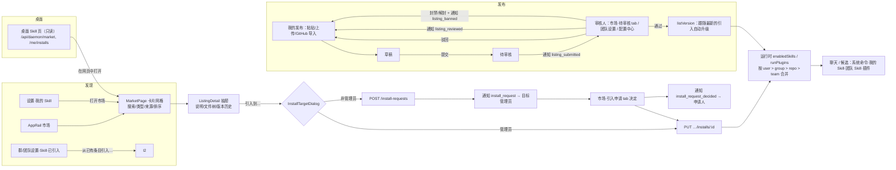

# 插件 / Skill 市场 · 体验迭代（5 轮）

目标：让「发现 → 详情 → 引入 → 使用 → 发布/更新 → 审核/封禁 → 申请引入 → 通知 → 桌面只读页 → 作品库与插件创作入口」整条链路更顺手、更省心。
每轮由一个 agent 接手：先读本文件，再做本轮条目，最后在文末追加「第 N 轮完成情况」。

约束（每轮都适用）：不随手加数据库迁移（需要的写进「待迁移」并说明理由）；不改 daemon（`crates/`），避免触发客户端发版；协议先改 `packages/protocol`；TDD；新文案加英文词条。

## 现状链路

## 痛点清单（影响 × 成本排序）

影响：高 = 主路径受阻或误导；中 = 多一步或要猜；低 = 观感。成本：S ≤ 半天、M ≤ 2 天、L 需迁移或跨端。

| # | 痛点 | 证据 | 影响 | 成本 | 状态 |
|---|------|------|------|------|------|
| 1 | 个人引入的 Skill 不出现在聊天 `/` 候选里（运行时会下发，但用户找不到入口） | `apps/server/src/modules/candidates/service.ts:148` 调 `enabledSkills` 没传 `originUserId`；`skills/service.ts:347` | 高 | S | 第 1 轮 ✅ |
| 2 | 市场卡片/详情看不出「我已经引入过」；引入对话框可重复选已引入的目标，提交后才 409 | `packages/protocol/src/market.ts` `MarketListingDto` 无引入状态；`InstallTargetDialog.tsx` 目标无标记 | 高 | M | 第 1 轮 ✅ |
| 3 | 审核人收不到「有版本待审核」通知；只能自己去团队设置/配置中心翻 | `market/publish.ts` `submitVersion` 只记日志 | 高 | S | 第 1 轮 ✅ |
| 4 | 封禁/解封不通知维护者，Skill 静默停止下发 | `market/publish.ts` `setBan` | 高 | S | 第 1 轮 ✅（维护者）；第 2 轮 ✅（引入方） |
| 5 | 通知里显示 slug 不显示标题；驳回/拒绝理由不显示；链接只到 tab 不到条目 | `requests.ts:224`、`publish.ts:525`、`notification-view.ts:142-176` | 中 | S | 第 1 轮 ✅ |
| 6 | 审核入口分散（团队设置·待审核 / 管理后台·配置中心），市场里没有 | `TeamAdminTabs.tsx:110`、`ConfigPage.tsx:323` | 中 | S | 第 1 轮 ✅（市场·待审核 tab） |
| 7 | 市场没有条目深链，通知/桌面/分享无法直达某个条目 | `MarketPage.tsx` 抽屉状态只在内存 | 中 | S | 第 1 轮 ✅（`?listing=`） |
| 8 | 群/团队设置 Skill 页没有去市场的入口；空态只有一句「还没有引入条目」 | `InstallList.tsx:52`、`GroupSettingsDialog.tsx:175`、`TeamAdminTabs.tsx:65` | 中 | S | 第 1 轮 ✅ |
| 9 | 同名冲突报错不说名字、不给解法；重复决定申请返回 404「不存在或已处理」 | `market/service.ts:228`、`requests.ts:242` | 中 | S | 第 1 轮 ✅ |
| 10 | 引入后详情/卡片不刷新，看不到刚引入的结果 | `MarketPage.tsx` 引入成功只 toast | 中 | S | 第 1 轮 ✅ |
| 11 | 跟随最新的引入被自动升级时，引入方（群/团队管理员、个人）无感知；也无「有新版本」提示（锁定版本的引入永不提示） | `market/service.ts:150-156`；`InstallDto` 无 `updateAvailable` | 高 | M | 第 2 轮 ✅（锁定版本「有新版本」+ 一键升级；跟随最新显示当前 rN；自动升级通知引入方）；「看过没升」需迁移 |
| 12 | 封禁/下架的引入在列表里只有标签，不显示原因、不引导移除 | `InstallList.tsx:29-33`；`InstallDto` 无 `banReason` | 中 | S | 第 2 轮 ✅ |
| 13 | 「从已有条目引入…」是光秃秃的单选列表：无描述、搜索、详情；与市场「引入到…」两套流程 | `InstallList.tsx:178-231` | 中 | M | 第 2 轮部分 ✅（搜索 + 描述）；与市场「引入到…」合并 → 第 3 轮 |
| 14 | 申请引入前看不到「别人已申请」；团队/仓库引入列表对普通成员不可读 | `market/routes.ts:85-102`、`requests.ts:218` | 中 | M | 第 3 轮 |
| 15 | 解封总是恢复为 `listed`，原先 `unlisted` 的条目被意外重新上架 | `publish.ts` `setBan`（`status: 'listed'`） | 中 | L（需记录封禁前状态） | 待迁移 |
| 16 | 市场 3 类通知都不推送浏览器/飞书；且无 teamId，在所有团队都显示 | `protocol/web.ts` `PUSHED_NOTIFICATION_TYPES`；`notify.ts:45-49` | 中 | S | 第 2 轮 ✅ |
| 17 | 术语不一：Skill/插件/条目；引入/安装；市场/Skill（桌面侧栏）；我的 Skill/我的个人 Skill/我的个人 | 桌面 `pages/index.ts:96-103`、`Market.tsx:104`；`InstallTargetDialog.tsx:78` | 低 | S | 第 1 轮部分（桌面「次安装」→「次引入」）；余下第 4 轮 |
| 18 | 桌面 Skill 页：无搜索、无详情、行不可点、「在网页中打开」只到 `/market`、错误原样 `String(e)`、不刷新 | `apps/desktop/src/pages/Market.tsx:19-110`、`src-tauri/src/commands/market.rs:43-48` | 中 | M（深链需改 tauri 命令） | 第 4 轮 |
| 19 | `/` 候选里的 Skill 名带内部前缀 `gonggong-team:`；插件段一律「打开创作面板」 | `candidates/service.ts:149`、`ComposerCandidates.tsx:203-215` | 中 | M（前缀由 agent 侧约定，改动需评估 daemon） | 第 3 轮评估 |
| 20 | 作品页「新建」禁用时只给提示「还没有开启创作插件的群」，无去开启/去市场的入口 | `apps/web/src/features/works/WorksPage.tsx:149-150, 271-281` | 中 | S | 第 3 轮 |
| 21 | 同名冲突在提交时才报，市场卡片/目标选择不预警 | `InstallList.tsx:140`、`market/service.ts` `skillNameFree` | 中 | M | 第 3 轮 |
| 22 | 运行后只显示「使用了 n 个个人 Skill」，看不到用了哪个 | `features/chat/RunGraphics.tsx:205-209` | 低 | S | 第 4 轮 |
| 23 | GitHub 上游只能手动「检查上游」；重复上传无「没有变化」提示 | `publish.ts:353, 448-450` | 低 | M | 第 5 轮 |
| 24 | 申请被撤回时管理员通知只标为已处理，不说明是撤回 | `requests.ts:285` | 低 | S | 第 2 轮 ✅ |

## 5 轮路线

1. **第 1 轮 · 找得到、看得清（本轮）**：个人 Skill 进 `/` 候选；市场显示「已引入」并防重复引入；条目深链；审核/封禁通知 + 通知带标题与理由；市场·待审核 tab；设置页去市场入口；友好报错。
2. **第 2 轮 · 更新与状态**：引入列表「有新版本 / 已自动升级到 rN」标记与一键升级（锁定版本）；封禁/下架原因与移除引导（`InstallDto` 带 `banReason`）；自动升级/封禁通知引入方；市场通知加入推送并带 teamId；撤回通知；「从已有条目引入」换成带搜索与描述的选择器（复用市场卡片）。
3. **第 3 轮 · 申请与冲突**：申请前展示「已有待处理申请」；「从已有条目引入…」与市场「引入到…」合并（点条目可看详情，或直接去市场带上目标）；成员可读团队/仓库引入列表；目标选择预检同名冲突并说明解法；作品页「新建」禁用时引导去群设置开启插件/去市场；评估 `/` 候选里去掉 `gonggong-team:` 前缀（只改展示，插入值不变）。
4. **第 4 轮 · 桌面与术语**：桌面 Skill 页加搜索、详情只读抽屉、刷新与友好错误、按条目「在网页中打开」（`/market?listing=`，需改 tauri 命令，随下次客户端发版）；统一术语表（市场/条目/引入/我的 Skill）；运行详情列出所用 Skill 名。
5. **第 5 轮 · 作者体验与收尾**：发布对话框预检（同名、可见性锁定说明）、重复上传提示「没有变化」、上游变更提醒；市场首页「推荐/最近引入」；全链路 e2e 冒烟与文案走查。

## 待迁移（留给后续轮次评估）

- 解封恢复封禁前状态：需要 `plugins` 记录 `status_before_ban`（或审计日志反查，但审计不可靠）。
- 「已看过的版本」/升级确认：需要 `installs.seen_version_id`，否则「有新版本」只能按 `listedVersionId` 与 `resolvedVersionId` 推算，无法区分「看过但没升」。
- 引入者与引入时间：`installs` 只有 `updatedBy/updatedAt`，无 `createdAt/installedBy`。
- 审核时间：`plugin_versions` 无 `reviewed_at`。
- 引入方通知收件人：目前取个人引入本人、其他层取 `installs.updatedBy`（最后设置这条引入的人）；若要发给「该群/团队全部管理员」或允许退订，需要订阅表或偏好字段。

## 第 1 轮完成情况

用户能感知的变化：

1. **聊天 `/` 候选新增「我的 Skill」段**（来源「个人引入」）：个人引入的 Skill 终于能在输入框里找到；只对本人显示。
   - 服务端 `commandCandidates` 传入当前用户；协议 `CommandCandidatesDto.skill[].personal`。
2. **市场显示「已引入」**：卡片右上角绿色「已引入」标签（悬停显示位置）；详情显示「已引入到：我的个人、支付核心群…」；「引入到…」里已引入的目标置灰并标「已引入」，个人层已引入时提示「已经引入到这里了」且不可提交；引入成功后详情与列表自动刷新。
   - 协议 `MarketListingDto.installedIn: InstalledTarget[]`（只列调用者可见的：个人、所在群、所在团队及其仓库），市场列表与详情返回，无需迁移。
3. **条目深链** `/market?listing=<id>`（可与 `tab=` 组合）：卡片点开即写入 URL，可分享，通知可直达。
4. **通知更完整**：
   - 新增 `listing_submitted`（提交审核 → 团队管理员或系统管理员，审核后自动标为已处理，链接到市场·待审核）。
   - 新增 `listing_banned`（封禁/解封 → 维护者，带原因，链接到「我的发布」并打开该条目）。
   - 审核结果、引入申请结果的通知显示条目标题（不再是 slug），驳回/拒绝时附上理由。
5. **市场新增「待审核」tab**：团队管理员看到各自团队的队列，系统管理员另有「公开条目」队列；普通成员不显示。
6. **设置页去市场**：群设置/团队设置的 Skill·已引入 与「我的 Skill」底部统一有「打开市场」按钮（会先关闭设置弹窗）；空态改为「还没有引入条目，可以去市场挑选 Skill 和插件」。
7. **友好报错**：同名冲突改为「这里已经有同名的 Skill「x」，先移除它再引入」；重复处理申请返回 409「这条申请已经处理过了」。
8. 桌面 Skill 页「次安装」统一为「次引入」。

测试：server `market-personal`/`market-requests`（候选、installedIn、提交/封禁通知、报错）、protocol `notification-view`、web `marketPage`/`market`/`chat`/`notifications`、desktop `market`。

没有数据库迁移，也没有改 daemon。

留给第 2 轮的提示：
- `installedIn` 已在协议里，可直接拿来做「有新版本」等状态。`InstallDto` 还需要补 `listedRevision`（目前 `listing.revision` 就是 listed 版本，维护者自测时 `resolvedRevision` 可能更大，要注意这一点）。
- 通知链接统一用 `/market?tab=…&listing=…`，`MarketPage` 会自动打开对应抽屉。

## 第 2 轮完成情况

用户能感知的变化：

1. **引入列表看得到版本状态**（群设置 / 团队设置 / 仓库 / 我的 Skill 共用 `InstallList`）：
   - 跟随最新显示当前下发版本「跟随最新 · r5」；锁定版本有更新时显示绿色「有新版本 r6」和「升级到 r6」按钮（升级后仍锁定在新版本）。
   - 「有新版本」只按 `listing.revision > resolvedRevision` 推算（无迁移）；维护者自测时 `resolvedRevision` 可能更大，不会误报。
2. **封禁/下架说清楚**：封禁行显示「封禁原因：…。下一轮起停止加载，建议移除」，删除图标换成红色「移除」按钮；下架行显示「已下架：继续使用 rN，不会再有新版本」。协议 `InstallDto.banReason`。
3. **引入方收到通知**：
   - 新类型 `listing_upgraded`：审核通过使跟随最新的引入升级时，通知引入方「A 群、我的个人 引入的 X 已自动升级到 r3：更新说明」，链接到条目详情；锁定版本的引入不通知（它们在列表里看到「有新版本」）。
   - `listing_banned` 增加引入方版本（payload 带 `targets`）：「A 群 引入的 X 已被封禁，下一轮起停止加载，建议移除：原因」/「…已解除封禁，恢复加载」。
   - 收件人：个人引入发给本人，群/团队/仓库引入发给 `updatedBy`；维护者与操作人本人跳过；同一人按团队合并成一条。
   - 被封禁的条目对「在可见位置引入过它」的人仍可打开详情（市场列表仍隐藏），详情显示封禁原因与「去设置里移除」提示，不显示「引入到…」。
4. **市场通知推送并归属团队**：`install_request`、`install_request_decided`、`listing_submitted`、`listing_reviewed`、`listing_banned` 加入浏览器推送 / 飞书通知（`listing_upgraded` 只进站内）；`notify()` 新增可选 `teamId`，市场通知按条目/目标所在团队归档，公开条目审核与个人引入的通知仍为全团队可见。
5. **撤回申请**：申请人撤回后，管理员那条通知变为「引入申请已撤回 · 米娅 撤回了把 X 引入到 A 群 的申请」（`resolveNotifications` 新增 `patch` 写入 `cancelled`）。
6. **「从已有条目引入」选择器**：加搜索（名称/描述）、每项显示描述、列表限高滚动、无匹配提示。

测试：protocol `notification-view`（升级/封禁引入方文案、撤回、推送类型）；server `market-requests`（升级通知只发跟随者、封禁通知带位置、通知 teamId、撤回标记、封禁详情对引入方可见、`InstallDto.banReason`）；web `market`（版本状态、升级、移除封禁、搜索）、`marketPage`（封禁详情提示）。

没有数据库迁移，也没有改 daemon。

取舍与留给后续：
- 「从已有条目引入」与市场「引入到…」两套流程的合并挪到第 3 轮（需要按目标预检冲突，和第 3 轮的同名冲突预警一起做更顺）。
- 管理后台直接改平台层插件（`plugins/service.ts` 里的 `listVersion`）不发升级通知，避免内置插件同步时群发。
- 已看过的版本、按群/团队全部管理员通知仍待迁移（见「待迁移」）。
- 桌面 Skill 页（第 4 轮）也可以用 `banReason` 与 `listing.revision > resolvedRevision` 显示同样的状态，服务端已返回。
