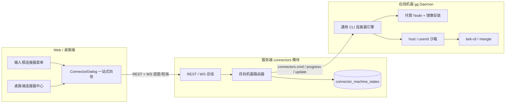

# 连接器 · 极致体验升级方案（三轮迭代）

> 提出：姜维川 2026-11-24。状态：已定待开工（承接 `docs/plan/连接器-方案.md` M1 与 §7 已拍板结论，对标 WorkBuddy 业务流程并针对共工多机多 Bot 协作架构做 3 轮递进优化与详细落地设计）。
> 适用范围：CLI 登录型连接器（飞书 `lark-cli`、飞书项目 `meegle` 及后续钉钉/企微等）为主，同步补齐密钥型连接器（数仓等）与桌面端体验短板。

## 1. 现状诊断（基于 v0.4.29 代码实查）

M1～第 3 轮已完成连接器的入口、弹窗版式、每群开关与图标，但内核仍停留在「把安装与登录甩给大模型在群聊里敲命令」，离「傻瓜式」存在 6 个核心断点：

| 级别 | 痛点 | 代码根因 |
|---|---|---|
| **P0** | **无自动检测，电脑已接飞书仍亮灰灯** | `apps/web/src/features/connectors/store.ts`（`needsCheck`）显式跳过所有 `connector.login` 类型；必须等 Bot 跑过一轮并手动调用 `connector_status` 才写入 `connector_states` |
| **P0** | **把安装和登录甩进公开群聊，靠 LLM 演 9 步** | `ConnectorDialog.tsx` 点击「在对话里连接」仅往输入框填一句 `@Bot 帮我连接飞书`，不发送、不自动检测；进入对话后要经历 `npm i -g`、`config init --new`、两次 `ask_group_members` 手动点「完成了吗」、再轮询，耗时长、烧 Token、刷屏且脆弱 |
| **P0** | **裸跑全局 npm，未复用共工托管运行时** | Skill 让 Agent 直接执行 `npm i -g @larksuite/cli`，易遇 Node 版本不足、无全局写权限、默认源超时或触发命令审批；而 `crates/gonggong/src/tools.rs` 已内置托管 Node ≥ 22、镜像源与免 sudo 安装器 |
| **P0** | **公开群发个人授权链接存在串号风险** | `ask_group_members` 卡片群内全员可见，他人误点会将自己账号绑进当前机器 CLI；且当前未按人隔离配置目录 |
| **P1** | **状态缺少 `machineId`，多 Bot 群出现假绿灯** | `connector_states` 唯一键为 `(user_id, team_id, name)`；用户在 A 机连好后，群里 `@` 跑在 B 机的 Bot 仍失败；`tryDraft.ts` 也仅盲选第一个未阻塞的 Bot |
| **P1** | **CLI 生命周期残缺 & 桌面端缺入口** | CLI 型弹窗隐藏了「重新检测」「退出登录 / 切换账号」与已授权范围；市场详情页（`ListingDetail.tsx`）直接把面向 Agent 的命令行 `SKILL.md` 展示给普通用户；桌面端无本机连接器体检入口 |

此外，密钥型连接器（数仓）在「如何获取」缺少直达指引、未自动清洗粘贴内容与实时验活、选填测试环境 Key 无表单入口，本方案一并收口。

## 2. WorkBuddy 对标与产品原则

| 环节 | WorkBuddy 做法（单人桌面端） | 共工现状（v0.4.29） | 共工目标（对齐 + 超越） |
|---|---|---|---|
| 状态发现 | 宿主自动探测本机，打开即见真实绿灯/过期态 | 永远灰灯「未确认登录」，等对话后置回报 | Daemon 毫秒级静默探测，开机/弹窗即准；已接电脑 0 步亮绿 |
| 依赖安装 | 宿主托管安装，对用户屏蔽 CLI 与终端概念 | LLM 在群里裸跑 `npm i -g`，易卡权限和审批 | 复用 Daemon 托管 Node + 镜像源免 sudo 安装，弹窗内简洁进度条 |
| 授权确认 | 弹窗内扫码 / 直拉浏览器 OAuth，自动回传状态 | 公屏发两张 yes/no 卡，授权后还要手动点「完成了」 | 弹窗内私密二维码 + 一键拉起浏览器 + 1.5s 自动轮询，两步自动无缝衔接 |
| 多机协作 | 单人单机，无多人共享场景 | 共享机串号风险；纯网页无客户端同事不知所措 | 本机默认复用 + 共享机按 `userId` 沙箱隔离；纯网页用户零安装直连 |
| 对话中缺连/缺权 | 提示前往面板配置 | 对话报错或文本教学，补完后需重新提问 | 输入框贴链接即浮预检胶囊；执行被拦发私密就地卡，扫码完自动续跑 |

**五条产品铁律**：
1. **能自动检测绝不让用户点确认**：本机已登录飞书时，打开共工即自动亮绿并展示姓名。
2. **安装与登录绝不进群聊、不烧 LLM**：全程由共工宿主（Daemon + Web/Desktop UI）确定性执行。
3. **用户只做最后一步授权**：依赖安装、应用初始化与轮询由系统接管，人只负责在飞书里点「同意」。
4. **个人授权链接绝不暴露到群公屏**：扫码二维码与授权 URL 仅在本人鉴权弹窗内展示。
5. **屏蔽多机拓扑，兼顾复用与隔离**：本人机器优先复用既有本机配置；他人/公共机器强制按 `userId` 隔离，绝不串号。

## 3. 关键决定（D1–D4，与 `连接器-方案.md` §7 完全对齐）

- **D1 · 协议通用化（不写死飞书）**：仿照 `PluginAgent`（`packages/protocol/src/plugins.ts`），在 `PluginConnector` 新增声明式 `cli` 段（含二进制名、托管包名、探测命令与账号/过期时间 JSON pointer），由 Daemon 通用引擎驱动。飞书（`lark-cli`）、飞书项目（`meegle`）及未来钉钉/企微 CLI 连接器共用一套检测、安装、授权、诊断管道。
- **D2 · 复用托管运行时**：沿用 `crates/gonggong/src/tools.rs` 的 `<home>/runtime`（Node ≥ 22）、国内镜像配置（`ToolsSettings.mirror`）与流式进度机制，将连接器 CLI 安装到 `<home>/tools/connectors/<name>`，零 `sudo`、不修改系统全局 npm。探测顺序为：**本机已安装路径（含 nvm/volta/fnm/brew 等目录）优先 → 共工托管目录兜底**。
- **D3 · 按人隔离 + 机主免扫码复用（推翻 M1「先不做隔离」）**：
  - 飞书应用维持**每人自建**（不做团队共用应用）；多台 Bot 电脑各自扫码，服务端绝不存 CLI token；
  - 统一按成员建独立配置档 `gg-<userId>`（飞书 `lark-cli --profile gg-<userId>` / `config init --new --name gg-<userId>`；飞书项目 `meegle --profile gg-<userId>`；需要 OS 文件权限强隔离时辅以 `0700` 目录隔离）；
  - **机主零配置体验**：当触发人 == 机器主人且默认档已登录本人时（通过租户级 `user_id` 与 `feishu_identities.feishu_user_id` 核对，避免不同自建应用 `open_id` 不一致；取不到时退回姓名并标「未核对」），直接识别/导入复用，**0 步免扫码**；
  - **无客户端用户解锁**：纯网页同事借群内在线 Bot 机器的 `gg-<userId>` 隔离档扫码连接，全程零安装、不串号。
- **D4 · 交付节奏与数据迁移边界**：
  - 与 §7 拍板节奏对齐：**R1 + R2 可合并作为首期主干交付**（机器自动探测 + 按人隔离 + 弹窗内一站式安装与扫码授权，含 1 次 `connector_machine_states` 增量迁移与 1 次 Daemon 发版）；也可先发 R1 探测无迁移灰度，再发 R2 持久化迁移；
  - **R3 随后交付**（静默续期与到期前 48 小时提醒、输入框 URL 预感胶囊、私密就地授权卡 + `rerunFor` 自动续跑、增量补权与故障一键自愈、桌面端连接器中心、数仓粘贴自动验活；含 `connector_requests` 迁移）。涉及迁移与客户端发版前仍按团队约定确认。

## 4. 技术架构与核心契约



### 4.1 协议扩展：`PluginConnector.cli`

在 `packages/protocol/src/plugins.ts` 的 `PluginConnector` 中新增可选字段 `cli`（保留 `login` 供旧版 Daemon 回退）：

```ts
// 示意结构（实施时用 zod 定义并补全 fixture）
cli?: {
  /** 可执行文件名，如 lark-cli / meegle */
  bin: string
  /** 托管安装方式，复用 tools.rs 镜像源与托管 Node */
  install: {
    npm: string                 // "@larksuite/cli" | "@lark-project/meegle"
    minNode?: string            // 默认 "18.0.0"
    postInstall?: string[][]    // 可选：如 meegle 安装后初始化 host
  }
  /** 驱动类型：闭集适配器，避免在清单里执行任意 shell */
  driver: 'lark-cli' | 'meegle'
  /** 沙箱隔离策略 */
  isolate:
    | { kind: 'envDir'; env: string }         // 如 LARKSUITE_CLI_CONFIG_DIR
    | { kind: 'profileFlag'; flag: string }   // 如 --profile
  /** 触发「输入态预感」的 URL 域名匹配（R3 使用） */
  urlHosts?: string[]           // 如 ["feishu.cn", "larkoffice.com"]
}
```

> 安全约束：`driver` 采用闭集枚举（如同 `PluginAgent` 选用固定策略集），Daemon 只执行代码内白名单参数，**绝不从插件清单拼接任意 shell 字符串**。

### 4.2 细粒度运行状态模型（6 态）

取代当前模糊的 `unchecked / ok / expired`，统一为可行动的状态机：

| 状态 | 含义 | 用户界面呈现 | 主按钮 |
|---|---|---|---|
| `ready` | 已装、已配、已登录有效 | 绿点 `已连接 · <姓名>` + 能力域徽章 | `去试试`（次操作：`重新检测` / `退出登录`） |
| `needs_login` | 已装已配，未登录或 Token 过期 | 灰/红点 `未登录` 或 `登录已过期` | `一键授权`（弹窗内直出二维码 + 拉起浏览器） |
| `needs_init` | 已装但未绑定应用（如 `lark-cli` `not_configured`） | 灰点 `未连接`（对用户隐藏 init 术语） | `连接`（弹窗内 2 步条自动串联建应用 → 授权） |
| `not_installed` | 未装 CLI | 灰点 `未连接` | `连接`（弹窗内自动托管安装 → 授权） |
| `no_machine` | 本人与本群均无在线可执行机器 | 灰点 `需要在线电脑或 Bot` | `安装桌面端` / 引导联系管理员上线 Bot |
| `error` | 网络、Keychain 或环境异常 | 橙点 + 一句人话原因 | `一键修复` / `重试` |

### 4.3 Daemon RPC 协议（新增 `DaemonFeature: 'connectors'`）

仿照现有 `tools.cmd / tools.progress / tools.result` 与 `agents.update`，在 `packages/protocol/src/daemon/` 新增：

- **Server → Daemon：`connectors.cmd`**
  - `requestId: string`
  - `action: 'detect' | 'install' | 'auth_start' | 'auth_poll' | 'auth_cancel' | 'logout' | 'doctor' | 'fix'`
  - `connector: string`（如 `feishu`、`meegle`）
  - `driver: 'lark-cli' | 'meegle'`
  - `install?: { npm: string; bin: string }`
  - `scope: { mode: 'host' } | { mode: 'sandbox'; userId: string }`
  - `params?: { sessionId?: string; domains?: string[]; bindSource?: string; fixKind?: 'keychain' | 'reinstall' }`
- **Daemon → Server**：
  - `connectors.progress`：`{ requestId, stage: 'node' | 'install' | 'init' | 'auth', percent?, line }`（推送给发起用户前端展示平滑进度，日志默认折叠）
  - `connectors.result`：`{ requestId, ok, state, auth?: { step: 'init' | 'login', stepIndex: number, stepTotal: number, url: string, userCode?: string, expiresAt: string, sessionId: string, done: boolean }, doctor?: DiagItem[], error?, errorCode? }`
  - `connectors.update`：Daemon `hello` 后、每 30 分钟定期巡检、每次运行前以及安装/授权完成后异步探测本机已声明的 CLI 连接器（仅只读、5s 超时），上报「机器 × 连接器 × 配置档」的安装态、版本、账号、租户 `user_id` 与过期时间。

### 4.4 CLI 驱动实测命令映射（已基于本机 `lark-cli 1.0.96` 与 `meegle 1.0.27` 核实）

| 动作 | 飞书（`lark-cli`） | 飞书项目（`meegle`） |
|---|---|---|
| **路径探测** | 依次查找：login shell `PATH`、nvm/volta/fnm/homebrew/npm/pnpm 全局目录、`<home>/tools/connectors/feishu/node_modules/.bin/lark-cli`（解决 macOS GUI 启动丢失 `PATH`） | 同左，目标为 `meegle` |
| **静默状态检测** | `lark-cli whoami [--profile gg-<uid>]` + `lark-cli auth status --json`（显式「重新检测」时加 `--verify` 并读 `auth scopes`；用租户级 `user_id` 核对 `feishu_identities.feishu_user_id`） | `meegle auth status --format json [--profile gg-<uid>]` |
| **已有应用探测** | 当 `not_configured` 时探测机主默认档或本机 Agent 配置：机主默认档已登录本人直接复用，已有应用可走 `lark-cli config bind` | 无需建应用，固定默认站点 `project.feishu.cn` |
| **第 1 步（仅飞书首次）** | Daemon 托管子进程运行 `lark-cli config init --new --name gg-<uid>`，捕获验证 URL 立即返回前端出二维码/拉起浏览器；退出码 0 时 `auth_poll` 自动推进至第 2 步 | 无此步，直接进入登录 |
| **授权发起** | `lark-cli auth login --no-wait --json --recommend --profile gg-<uid>`（增量补权时改 `--domain <d>`），直接解析 JSON 中的验证 URL 与 `device_code` | `meegle auth login --host project.feishu.cn --profile gg-<uid> --device-code --phase init --format json` |
| **1.5s 自动轮询** | 前端每 1.5s 调 `auth_poll`，Daemon 驱动 `lark-cli auth login --profile gg-<uid> --device-code <code>`，完成后立即调 `whoami` 核对身份并返回 `ready` + 账号名 | `meegle auth login --host project.feishu.cn --profile gg-<uid> --device-code --phase poll --device-code-value <v> --client-id <id> --once --format json` |
| **退出登录** | `lark-cli auth logout --profile gg-<uid>`（彻底解绑提供清理该档配置 `config remove`） | `meegle auth logout --profile gg-<uid>` |
| **诊断与自愈** | `lark-cli doctor`；macOS 钥匙串锁异常时提供一键 `lark-cli config keychain-downgrade` | `meegle auth status` + `meegle config show` |

> **关键体验细节**：在共工桌面端（Tauri）点击「在浏览器 / 飞书中打开授权」时，直接通过宿主 `opener` 拉起系统默认浏览器；在纯 Web 端则同时展示 `QRCodeSVG` 二维码与外链按钮。无论哪种方式，用户在浏览器点完「同意授权」后无需切回点「完成了」，1.5s 内界面自动翻绿。

### 4.5 多机拓扑、沙箱注入与智能选 Bot（R2）

1. **目标机器选择优先级（当用户在某群点「连接」时）**：
   1. 本人拥有的、在本群有在线 Bot 的机器（`host` 模式）；
   2. 本人拥有的任意在线机器（`host` 模式，如个人私聊/跨群场景）；
   3. 本群可用的其他在线 Bot 机器（支持 `connectors` 特性，强制 `sandbox` 模式，为纯网页无客户端用户兜底）；
   4. 若均不可用，返回 `no_machine` 态并给出安装桌面端引导。
2. **执行回合的环境变量注入（`apps/server/src/modules/runs/scheduler.ts` + Daemon）**：
   - `RunStart` 下发时，服务端附带每个启用 CLI 连接器对本次 `(originUserId, machineId)` 的运行模式（`host` 或 `sandbox`）；
   - Daemon 启动 Agent 进程时：
     - 将已托管安装的 `<home>/tools/connectors/*/node_modules/.bin` 追加到进程 `PATH` 尾部（不抢占用户本机已有 CLI）；
     - 按本次发起人注入对应配置档标识（机主复用默认档时走默认 profile；隔离模式统一为 `gg-<originUserId>`，飞书支持 `--profile gg-<originUserId>` 或按需注入 `LARKSUITE_CLI_CONFIG_DIR=<home>/connectors/feishu/<originUserId>` 实现 OS 级目录隔离；飞书项目通过专用 env 透传 `--profile gg-<originUserId>` 并在 Skill 指令中强制携带）。
3. **群内状态聚合与智能 `@Bot`**：
   - `ConnectorDto` 扩展按本群 Bot 所在机器汇总的状态（例如菜单摘要显示 `已连接 · 姜维川（Mac-mini）`，多机未齐时折叠展开各机状态）并标出 `readyBotIds`；
   - `tryDraft.ts` 点击「去试试 / 试试这样用」时，按 **本机已连接 Bot ＞ 共享机已为我连接 Bot ＞ 本机在线 Bot ＞ 其他在线 Bot** 排序自动 `@`；
   - 用户手动 `@` 了未连接飞书的 Bot B 而群内 Bot A 已连好时，输入框上方轻提示：`Bot B 所在电脑尚未连接飞书 · [切换 @Bot A] [立即连接]`。

### 4.6 数据模型变动

- **R1**：**无数据库迁移**。在线机器的 CLI 检测结果存服务端内存（`hub` 扩展状态表），断开重连时由 `hello` 自动重建；保留现有 `connector_states` 兼容旧版 Daemon。
- **R2（1 次增量迁移）**：新增 `connector_machine_states` 表：
  - 字段：`id`, `user_id` (FK users), `machine_id` (FK machines, onDelete cascade), `name` (连接器名), `profile_mode` (`'host' | 'sandbox'`), `profile_name` (text, 如 `default` / `gg-<uid>`), `status` (`'ready' | 'needs_login' | 'needs_init' | 'not_installed' | 'error'`), `account` (text, nullable), `identity_verified` (boolean, 租户级 `feishu_user_id` 核对结果), `scopes` (jsonb `string[]`, nullable), `cli_version` (text, nullable), `expires_at` (timestamptz, nullable), `detail` (text, nullable), `checked_at` (timestamptz)。
  - 唯一索引：`(user_id, machine_id, name)`。
- **R3（1 次增量迁移）**：新增 `connector_requests` 表（用于执行态私密就地授权卡与自动续跑）：
  - 字段：`id`, `group_id`, `run_id`, `user_id`（仅发起人可操作）, `connector`, `reason` (`'unconnected' | 'expired' | 'missing_scope'`), `missing_domain` (text, nullable), `message_id`, `resolved_at`, `created_at`。
  - 当发起人在私密弹窗完成授权后，服务端更新 `resolved_at`、刷新群内卡片为「已完成连接」，并调用现有 `rerunFor(ctx, run)` 自动续跑挂起的回合。

## 5. 三轮递进交付与验收标准

每轮独立可用、独立验收、严格遵循 TDD（先写失败的集成/单元/E2E 测试再实现）。

### 第 1 轮（R1）：去对话化 + 自动检测 + 弹窗一站式授权

- **目标**：彻底把 CLI 连接器的检测、安装、授权从对话流剥离到宿主，实现 WorkBuddy 级傻瓜体验。
- **迁移 / 发版**：无数据库迁移；需发布 1 版 Daemon（含 `connectors` 特性，旧版兼容回退）。
- **交付切片**：
  1. **协议与 Fixture（`packages/protocol`）**：`PluginConnector.cli`、`ConnectorRuntimeState`、`DaemonFeature: 'connectors'`、`connectors.cmd / progress / result / update` 契约与 TS/Rust 往返 fixture。
  2. **Daemon 引擎（`crates/gonggong`）**：全路径 CLI 查找器（覆盖 nvm/volta/fnm/brew/托管目录）、复用 `tools.rs` 托管 Node+镜像免 sudo 安装、内置 `lark-cli` 与 `meegle` 驱动（`whoami`、`config init --new`、`auth login --no-wait --json`、`meegle --phase init|poll`、`logout`）、`hello` 后静默检测推送、进程 `PATH` 注入。
  3. **服务端中继（`apps/server`）**：`/api/groups/:id/connectors/:pluginId/{detect,install,auth/start,auth/poll,auth/cancel,logout}` 接口；复用 `machines/relay.ts` 权限与超时控制；WS 推送安装进度与状态变更；旧版 Daemon 降级保持原行为。
  4. **Web 弹窗与市场净化（`apps/web`）**：
     - `ConnectorMenu` 打开即展示实时检测态（本机已接直接绿灯 + 姓名）；
     - `ConnectorDialog` 改造为 3 阶段一站式向导（自动安装进度条 → 二维码 +「在飞书/浏览器中打开」+ 1.5s 自动轮询，飞书两步无感衔接 → 已连接态含能力域徽章、`去试试`、`重新检测`、`退出登录`）；
     - 市场详情页（`ListingDetail.tsx`）对连接器折叠面向 AI 的 `SKILL.md` 到「开发者技术说明」，首屏只展示人话能力与示例。
  5. **内部插件更新（`tools/gonggong-plugins`）**：`feishu`、`meegle` 清单补充 `connector.cli`；瘦身 `SKILL.md`（优先依赖已连接环境，仅在旧版客户端回退时保留对话登录指令）。
- **验收标准**：
  - [ ] **已接飞书 0 步识别**：测试机本机已登录 `lark-cli`，启动 Daemon 后打开 Web 连接器菜单，1 秒内显示绿点 `已连接 · <姓名>`，无需点击任何连接按钮。
  - [ ] **未装依赖一键拉起**：测试机未装 `lark-cli`，在弹窗点「连接飞书」→ 自动走托管 Node + 镜像安装（展示进度条，不进群聊、不弹审批）→ 自动出二维码与授权按钮 → 模拟授权通过后 2 秒内自动变绿并展示「去试试」。
  - [ ] **退出与重检闭环**：点击「退出登录」状态回退未登录；点「重新检测」实时刷新。
  - [ ] **旧版 Daemon 兼容**：无 `connectors` 特性的 Daemon 仍正常显示「在对话里连接」不报错。

### 第 2 轮（R2）：多机拓扑 + 按人沙箱隔离 + 纯网页无客户端直连

- **目标**：攻克共工独有的团队多机多 Bot 难题，实现「本机零配置复用 + 共享机零串号 + 无客户端同事网页直连」。
- **迁移 / 发版**：1 次增量迁移（`connector_machine_states`）；Daemon 随迭代升级沙箱与 `config bind` 支持。
- **交付切片**：
  1. **数据层（`apps/server`）**：新增 `connector_machine_states` 迁移；按 `(userId, machineId, name)` 读写；机器离线/解绑自动清理或标离线。
  2. **Daemon 沙箱（`crates/gonggong`）**：支持 `scope: { mode: 'sandbox', userId }`（`LARKSUITE_CLI_CONFIG_DIR` 与 `meegle --profile`），在 `RunStart` 执行回合时按发起人自动注入隔离环境；`needs_init` 时探测本机已有飞书配置并支持 `config bind` 复用选项。
  3. **服务端路由与聚合（`apps/server`）**：按 §4.5 优先级选择执行机（允许无本机用户走群内共享 Bot 沙箱）；群连接器列表聚合为面向用户的单一状态并附带 `readyBotIds`。
  4. **Web 智能体验（`apps/web`）**：`tryDraft.ts` 优先 `@` 已就绪 Bot；用户手动 `@` 未连接 Bot 时输入框展示轻提示胶囊（支持一键切 Bot 或立即连接）；多台本人机器连接状态收进详情弹窗底部折叠区。
- **验收标准**：
  - [ ] **多人共享机零串号**：成员 A、B 同用同事机器上的公共 Bot 分别扫码连接各自飞书，两人各自触发查日程时互不覆盖、互不串号，目录物理隔离。
  - [ ] **纯网页零安装闭环**：无任何绑定机器的新成员在纯浏览器打开群聊 → 点「连接飞书」→ 弹窗明示「独立个人隔离空间」并出二维码 → 扫码完成后直接可用。
  - [ ] **智能选 Bot**：群内 Bot A 未连、Bot B 已连，点「去试试」自动 `@Bot B`；手动 `@Bot A` 时出现轻提示条。

### 第 3 轮（R3）：意图即连接 + 断点续跑 + 无感自愈 + 桌面端连接器中心 + 密钥型补齐

- **目标**：消除「先去配置连接器」的割裂感，把连接与修复无缝嵌入真实对话流与桌面端首屏。
- **迁移 / 发版**：1 次增量迁移（`connector_requests`）；桌面端新增「连接器」侧栏页。
- **交付切片**：
  1. **输入态预感（`apps/web`）**：输入框监听粘贴/输入的 URL，命中已开启但未连接/已过期连接器的 `urlHosts`（如 `feishu.cn`、`project.feishu.cn`）时，在草稿上方浮现胶囊条「检测到飞书链接 · [一键连接]」，弹窗内完成授权后不丢草稿。
  2. **执行态私密就地卡 + 自动续跑（`apps/server` + `apps/web` + 飞书镜像）**：
     - 新增 Agent 工具 `connector_request`（缺连接、Token 过期或缺少单域权限如 `mail` 时调用），发出统一「就地连接卡」；
     - 群公屏只展示状态与按钮（绝不贴授权链接），仅触发人可点击拉起私密弹窗；
     - 授权完成自动刷新卡片并调用 `rerunFor` 续跑挂起回合；飞书镜像卡片附回链直达该私密授权弹窗。
  3. **静默续期、增量补权与一键自愈（`crates/gonggong` + `packages/protocol` + `apps/web`）**：
     - **静默续期**：Daemon 每天对已登录配置档调用一次轻量接口滚动 refresh token，临近到期前 48 小时由服务端发私信提醒重新授权，避免干活中途突然掉登录；
     - 新增 `packages/protocol/src/connector-errors.ts`，将 CLI 常见故障（Node 缺失、镜像超时、macOS Keychain 锁、个人应用未启用、缺单域 Scope）映射为「人话原因 + 一键修复按钮」；
     - 缺单域权限调用 `lark-cli auth login --profile gg-<uid> --domain <d>` 增量补权；Keychain 异常一键执行 `lark-cli config keychain-downgrade`。
  4. **桌面端「连接器中心」（`apps/desktop`）**：侧栏与「Agent」并列新增「连接器」页，复用 Web 组件与 Tauri 本地 IPC，开箱自动体检本机所有连接器，支持一键安装/升级 CLI、`doctor` 体检与直接拉起系统浏览器授权。
  5. **密钥型连接器同步极致傻瓜化（`apps/web` + 内部 `dw` 插件）**：
     - 数仓「如何获取」配直达签发页深链与折叠步骤提示；
     - Key 输入框自动 trim 并剥离误复制的 `Bearer ` 前缀，输入后 300ms 自动静默验活并展示结果（不需先提交报错再改）；
     - 选填密钥（测试环境 Key）收进弹窗「高级 / 测试环境」折叠区，随时可配可测。
- **验收标准**：
  - [ ] **意图直连**：未连接飞书时在输入框粘贴 `feishu.cn/docx/...` 链接，立即浮现胶囊条，点一键连接扫码后草稿完整保留。
  - [ ] **断点续跑**：直接发 `@Bot 总结这篇飞书文档` → Bot 发就地连接卡 → 其他成员点击提示「仅发起人可连接」→ 发起人弹窗扫码完成 → 原任务自动续跑并产出总结，公屏 0 条授权链接泄露。
  - [ ] **自愈与增量补权**：模拟缺 `mail` 权限或 Keychain 报错，弹窗给出人话原因与一键修复按钮并恢复正常。
  - [ ] **数仓丝滑填写**：粘贴带 `Bearer ` 前缀的有效 Key，300ms 内自动清洗并亮绿提示有效；测试 Key 可在折叠区独立配置与测活。

## 6. 安全边界与风险控制

1. **零凭据入服务端**：CLI 连接器的 OAuth Token、App Secret 始终留在执行机本地（`host` 默认位置或 `<home>/connectors/<name>/<userId>` 权限 `0700`），服务端与日志只保存 `status`、`account`、`scopes` 与脱敏诊断信息。
2. **零公屏链接泄露**：`auth_start` 生成的 `verification_uri` 与 `device_code` 仅经 HTTPS 返回给发起人本人的前端弹窗，不落聊天消息表、不进群事件、不镜像飞书群。
3. **跨机器授权边界**：共享机沙箱模式下，服务端仅允许成员操作自己的 `sandbox/<userId>` 目录，禁止读取或覆盖机器主人（`host`）及其他成员的目录；退出登录时仅清理本人沙箱。
4. **超时与残留清理**：Daemon 维护中的 `config init` / `auth login` 托管子进程带 10 分钟硬超时，弹窗关闭时发送 `auth_cancel` 回收进程，避免僵尸进程。
5. **平滑回滚**：R1 无迁移、R2/R3 均为纯新增表；任何一轮回退均不影响既有 M1 连接器功能与历史数据。

## 7. 明确不做

- 不耦合平台飞书主应用（`docs/domains/飞书联动.md` 负责登录与群消息镜像，连接器坚持走用户本人 CLI 体系）。
- 不在服务端代管或跨机明文同步用户的 CLI Token（多台本人电脑采用各自一键扫码，保持零中心化凭据风险）。
- 不开放任意第三方自定义 shell 命令的 CLI 连接器安装（`driver` 严格走内置白名单审核）。
